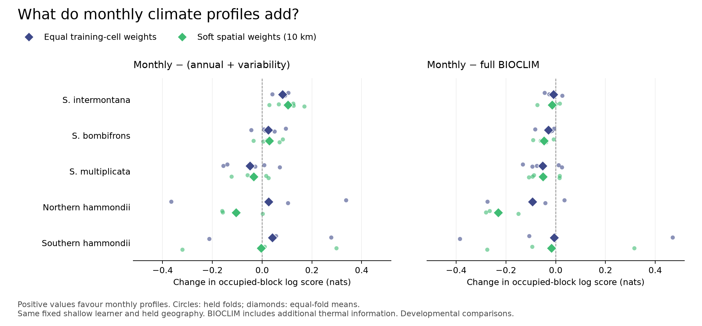

# Spea climate and biogeography

**How much does the way we describe climate change our predictions for spadefoot toads? And what can those predictions contribute to historical biogeography?**

This is the public research companion for Kevin M. Neal's ongoing work on *Spea*. It contains a working manuscript, numerical results, figures and selected analysis code. **Version 0.2.0 is a developmental snapshot dated 21 October 2026**, adding a bounded environmental-organization study completed on 20 October. The central climate comparisons remain those completed through 5 October. It has not received independent peer review. The [change log](CHANGELOG.md) records additions and corrections, and earlier release tags preserve their snapshots.

[Working manuscript](docs/manuscript.md) · [Methods](docs/methods.md) · [Reproduce the tables](REPRODUCIBILITY.md) · [Environmental organization](docs/environmental_organization.md) · [Biogeographic questions](docs/research_agenda.md)

## What we have found

We compared annual climate, annual climate plus two variability summaries, monthly profiles, and the 19 BIOCLIM variables. The five fitting units are *S. intermontana*, *S. bombifrons*, *S. multiplicata*, and northern and southern *S. hammondii* operational units informed by prior genetic evidence. These are five analysis units, not five independent species-level replications.

The models predict **where occurrences are recorded relative to available land area**. Evaluation holds out geographical regions and asks how the model allocates relative recording density within them. These data do not measure pond occupancy, physiological tolerance, or observer effort.

- **Monthly profiles add useful information beyond simple variability summaries for intermontana.** Under matched shallow models, the mean gain is +0.082 or +0.104 nats with equal or soft spatial training weights; all five folds have positive gains in both arms.
- **That does not make monthly profiles the best representation.** Full BIOCLIM has the higher mean primary score in every unit under both weighting arms. Its advantage over monthly for intermontana is small; secondary metrics can favour monthly. BIOCLIM also includes thermal information absent from monthly mean-temperature inputs, so this is not a pure test of compression or seasonality.
- **Sampling and evaluation choices matter.** Bombifrons has a smaller monthly increment, multiplicata a negative mean increment, and northern/southern hammondii results depend on fitting and weighting procedures. Added statistical summaries, thinning and soft spatial weights have mixed effects.



*Primary score changes under the matched fixed shallow comparison. Small circles are individual held folds; diamonds are equal-fold means. Positive values favour monthly profiles. The two panels use the same horizontal scale. Fold spread is descriptive, and these geographical folds were reused during development.* [All primary and secondary scores](data/README.md).

## What you can run

The main table replay needs **Python 3.13 and its standard library only**. It runs offline after cloning; no climate downloads, account credentials or model packages are required.

```sh
git clone https://github.com/kevinmneal/spea-climate-research.git
cd spea-climate-research
python3 scripts/replay.py --output replay_output
```

This reconstructs the original selected/fixed tables, the later matched weighting/BIOCLIM tables, and the environmental-organization statistics and control envelopes. It checks them against the saved summaries. Start with `replay_output/matched_primary_table.md`, `replay_output/original/table2.md` and `replay_output/environmental_organization/observed_table.md`.

**This is aggregate reproduction.** The public snapshot does not rebuild occurrences, fit the models, or recompute their native-grid predictions. [The reproducibility statement](REPRODUCIBILITY.md) specifies exactly what is and is not supplied. The optional [scientific components](src/README.md) include the actual monthly transformations, fourteen added summaries, thinning and spatial weights, with tests and a clearly synthetic example.

## Broader research direction

The wider project investigates candidate geographical structure in *S. intermontana*, contemporary environmental contrasts, and constraints on late-glacial and postglacial histories. Completed local cost comparisons and a provincial response comparison have produced useful negative or mixed results. Historical climate compatibility and sparse independent population coverage constrain stronger conclusions.

A [bounded October follow-up](docs/environmental_organization.md) asked whether recorded environments in *S. intermontana* support a reproducible two-component description beyond sampled geography and specified climatic associations. Across three prespecified representative selections, the two-component approximation predicted held climates less well than the one-component reference. The primary result fell within the shared- and gradual-association simulation envelopes; one sensitivity exceeded both upper envelopes but did not recur. This screen supplies no stable new division. Because conditioning on sampled blocks removes most broad rainfall-timing variation, regional ecological differences remain unresolved.

The [research agenda](docs/research_agenda.md) separates those exploratory results from the climate manuscript and identifies the biological evidence needed next. No new lineage, species boundary, dispersal rate or colonization date is established here.

## Navigate the snapshot

| Material | Contents |
|---|---|
| [Manuscript](docs/manuscript.md) | Full comparative argument, results, qualifications and references |
| [Methods](docs/methods.md) | Observation units, backgrounds, folds, predictors, fitting and score definitions |
| [Aggregate data](data/README.md) | Original/matched seasonal folds, environmental-organization statistics and envelopes, plus sensitivity and decomposition tables |
| [Environmental organization](docs/environmental_organization.md) | Separate exploratory study with its negative result, sensitivity discrepancy and conditional-inference limit |
| [Reproducibility](REPRODUCIBILITY.md) | Commands, verification scope and missing inputs for full native reproduction |
| [Scientific components](src/README.md) | Selected original numerical code and its tests |
| [Provenance](provenance.json) | Source checkpoint, original file hashes and disclosed export adaptations |
| [Change log](CHANGELOG.md) | Versioned changes and corrections |

The full working archive remains private. This repository has its own history and contains a deliberate selection of original project material, without raw localities, specimen casework, downloaded papers or large model assets. The seasonal study map uses 25-km display tiles; the environmental-organization map uses inherited 50-km block centers. Neither is a release of exact localities.

## Attribution and reuse

Maintained by **Kevin M. Neal**. Please cite the version you use; GitHub's “Cite this repository” entry is supplied by [CITATION.cff](CITATION.cff). This is a research snapshot, not a published journal article or a DOI-registered deposit.

Code, computational review and editorial preparation used OpenAI Codex assistance. AI-assisted review and passing software checks are not independent scientific peer review. Corrections and substantive methodological discussion are welcome through repository issues; please do not post sensitive localities there.

Original software is available under the [MIT license](LICENSE). Original prose, figures and aggregate tables are [CC BY 4.0](https://creativecommons.org/licenses/by/4.0/). Referenced third-party datasets and publications retain their own terms; [NOTICE](NOTICE.md) records the distinction and method attribution.
