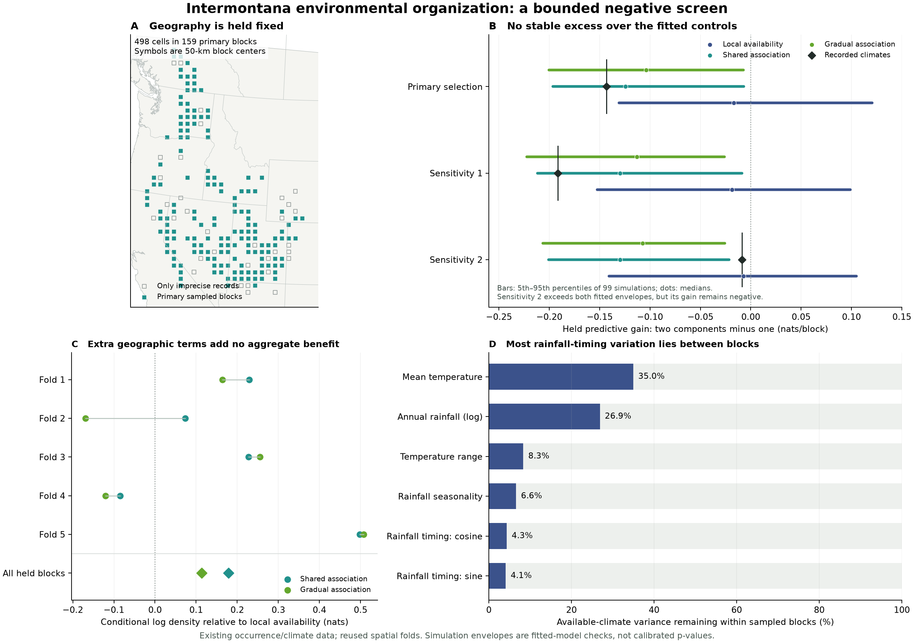

# Environmental organization in intermontana: a bounded negative screen

Analysis completed 20 October 2026; public update 21 October 2026. This exploratory study is separate from the [climate-representation manuscript](manuscript.md). It uses existing records, climates and development folds; it is not independent biological validation.

**This fixed screen found no stable candidate environmental division.** Across three prespecified choices of one recorded cell per geographic block, a two-component Gaussian approximation predicted held climates less well than a one-component approximation. The primary result fell within the specified shared- and gradual-association simulation envelopes. One sensitivity exceeded both fitted upper envelopes, despite retaining a negative two-component gain; that discrepancy remains unresolved. The screen is complete. It does not establish ecological homogeneity across the range.



*Panel A shows 50-km block centers in the inherited project Albers grid, not exact occurrence locations. Panel B gives the 5th–95th percentiles and medians of 99 simulations per generator for each of three representative selections. Panel C displays the conditional association scores; figure folds 1–5 correspond to stored IDs 0–4. Panel D gives the fraction of available-climate variance lying within occupied blocks. This is the corrected, visually inspected map; no scientific score changed during its preparation.* [SVG](../figures/environmental_organization.svg).

## Question and design

The question was whether recorded environmental organization exceeds that reproduced by the sampled geography and specified shared or gradually varying climatic associations. Seasonal information can help predict recorded environments without implying distinct ecological populations.

The original input contains 709 recorded climate cells in 195 blocks. Of these, 703 cells in 193 blocks lie inside the existing primary availability mask. The primary analysis retains 498 cells in 159 blocks with known reported uncertainty at most 5 km and no contributors of unknown radius. Six outside-mask cells remain in the source audit, and 205 in-mask cells fail the precision criterion. The original cohort and mask were not changed. The primary cohort is dominated by GBIF-sourced cells (494 of 498); reported precision still permits extraction error and block-boundary crossings.

Six physical summaries were fixed before examining the new organization results: mean temperature, log1p annual precipitation, monthly temperature range, precipitation coefficient of variation, and the cosine and sine first harmonics of monthly precipitation fractions, with January at angle zero. The harmonics retain magnitude as well as calendar direction. Inputs are existing CHELSA 2.1 monthly normals for 1981–2010; the summaries do not exhaust monthly shape, event weather, hydroperiod or habitat.

Each of three fixed representative selections chooses one observed cell uniformly within each block without examining its climate. The first is primary and the others are sensitivities, not independent biological samples. Original train/test membership determines each representative's role in the five inherited geographic folds. Scaling uses training-block availability only. One- and two-component Gaussian approximations have tied full covariance, covariance regularization 0.05, five initializations, tolerance 1e-5 and a 500-iteration limit. No component-count or feature search was undertaken. Exact settings are in the [design record](../metadata/environmental_organization_design.json).

The statistic is the sum of held two-minus-one log-density differences divided by the held representative count. A positive value would indicate a better predictive density approximation under this procedure, not the existence of two biological groups. Continuous skewed or curved distributions can also benefit from mixtures.

## Alternatives with sampled geography held fixed

Every generator samples one native cell in each of the same 159 primary blocks. All 613,266 eligible native cells within those blocks contribute their physical areas to the complete block normalizers.

| Generator | Within-block probability |
|---|---|
| Local availability | Proportional to native-cell area |
| Shared climatic association | Area times exp of six linear and all 21 quadratic climate terms |
| Gradually varying association | The same 27 terms plus six linear climate terms interacting with two standardized geographic block-center coordinates: 39 terms total |

Each block has equal fitting mass, divided among its recorded cells. Basis columns are centered within blocks and divided by one pooled training-availability within-block scale. The fixed ridge penalty is squared coefficient norm divided by twice the number of training blocks, added to mean-block conditional loss. Both model forms were fitted to the full primary cohort for simulation and separately in each training fold for the conditional score comparison below. All 12 fits converged; full-data basis ranks were 27/27 and 39/39.

There are 99 simulated datasets per generator. Each passes through the same mixture procedure under all three representative-role layouts. Simulated locations move within their fixed blocks while retaining those roles; pointwise spatial guards are not recalculated for the simulated cells. These are fitted-model diagnostics with parameters plugged in, **not calibrated p-values**. They do not estimate observer effort, integrate fitted-parameter uncertainty or eliminate residual spatial dependence. Conditioning removes between-block recording-density differences while leaving the within-block recording process unresolved.

## Results, including the discrepancy

| Selection in the precise cohort | Held blocks | Two-minus-one gain, nats/block | Shared simulations at or above | Gradual simulations at or above |
|---|---:|---:|---:|---:|
| Primary | 122 | −0.143285 | 61/99 | 72/99 |
| Sensitivity 1 | 119 | −0.191651 | 87/99 | 91/99 |
| Sensitivity 2 | 119 | −0.008719 | 4/99 | 4/99 |

All three gains are negative, and no observed fold triggers the prespecified small-component flag. Held counts differ because selected cells can have different original eligibility.

The primary statistic lies inside the shared envelope (5th–95th percentiles −0.19649 to −0.00679) and the gradual envelope (−0.20030 to −0.00736). It lies below the local-availability 5th percentile, whose envelope is −0.13072 to +0.12038. This is no upper-tail excess; uniform availability does not thereby explain the full recorded distribution.

Sensitivity 2 exceeds both fitted 95th percentiles: −0.02153 for shared and −0.02580 for gradual association. Only 4/99 simulations from each reach or exceed its value. The negative two-component gain does not erase this mismatch: comparison against one Gaussian and comparison against a fitted-generator envelope answer different questions. The discrepancy does not recur in the other selections and supplies no stable candidate division. All [nine envelopes](../data/environmental_organization/envelope_summary.csv) and the [fold-level components](../data/environmental_organization/mixture_fold_scores.csv) are retained.

The broader 703-center cohort gives gains of +0.005570, −0.147272 and −0.096324, with 146, 143 and 146 held blocks. Its small primary positive value does not recur. These centers received the same mixture settings but no additional association fitting or simulations; their larger or unknown positional uncertainty is not repaired by using centers.

The separate conditional association check uses all eligible primary held cells:

| Stored fold | Held blocks | Shared versus local availability, nats | Gradual versus local availability, nats |
|---|---:|---:|---:|
| 0 | 30 | +0.228886 | +0.164266 |
| 1 | 28 | +0.073354 | −0.169268 |
| 2 | 26 | +0.227328 | +0.255129 |
| 3 | 27 | −0.084461 | −0.120170 |
| 4 | 23 | +0.497953 | +0.507234 |
| All held blocks | 134 | **+0.179131** | **+0.113759** |

The aggregate covers 358 cells and weights held blocks equally, not folds equally. Extra spatial terms reduce the aggregate score by 0.065372 nats and help in two of five folds. This supports the simpler procedure within this comparison, without establishing a universally shared biological response. Both models lose to local availability in fold 3; the gradual model also loses in fold 1.

## The main scientific limit

Only 35.0% of available mean-temperature variance, 26.9% of log-rainfall variance, 8.3% of temperature-range variance, 6.6% of rainfall-CV variance and **4.3%/4.1% of rainfall cosine/sine variance** lie within the occupied blocks. Holding blocks fixed therefore also removes much broad regional rainfall-timing contrast. Full basis rank does not restore that information.

The result concerns this six-variable statistic and these specified generators. It does not exclude broader regional ecological differences, establish adaptation or ancestry, or validate every possible continuous response. The developmental folds, uneven source composition, positional uncertainty and unknown recording effort remain limitations. This screen and the earlier seasonal/provincial studies reuse data and should not be counted as independent confirmations of one null hypothesis.

The decision is to close this fixed screen without a new group map or automatic variable/count/smoother search. Future work should start from an independently motivated contrast and observations capable of separating its explanations; the [research agenda](research_agenda.md) retains that broader purpose.

## What the public replay verifies

Run the [main replay](../REPRODUCIBILITY.md), or just this module:

```sh
python3 scripts/replay_environmental_organization.py --output environmental_replay_output
```

It reconstructs 897 organization statistics from 4,485 fold rows, all nine envelopes, and the two conditional association aggregates from ten fold rows. It checks complete expected slots, diagnostic consistency, cohort-count identities and the six saved variance fractions' percentage conversions. It retains the observed and broader-center outcomes and the unusual sensitivity rank. [Data definitions](../data/environmental_organization/README.md).

The replay does not regenerate climate inputs, representative selections, GMM fits, fitted generators, simulations or native variance estimates. The working archive's separate numerical verification passed 1,405 checks with eight focused analysis tests; those native checks are not reproduced by this public module. Checksums establish file identity, aggregate replay checks arithmetic, and neither supplies independent biological evidence.
