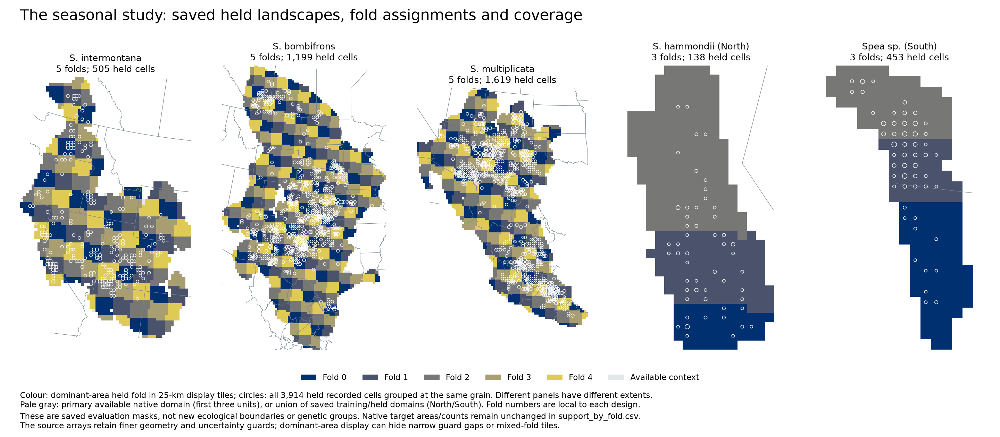
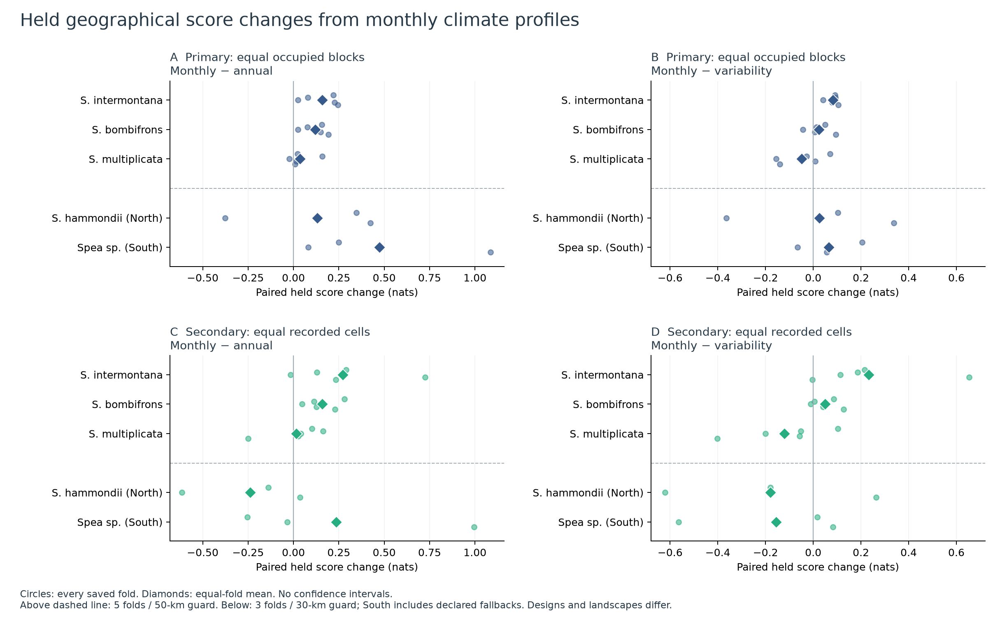
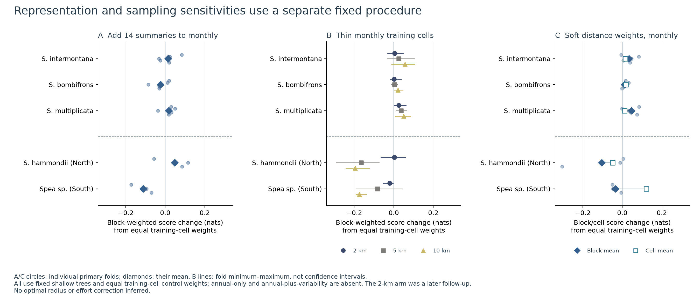
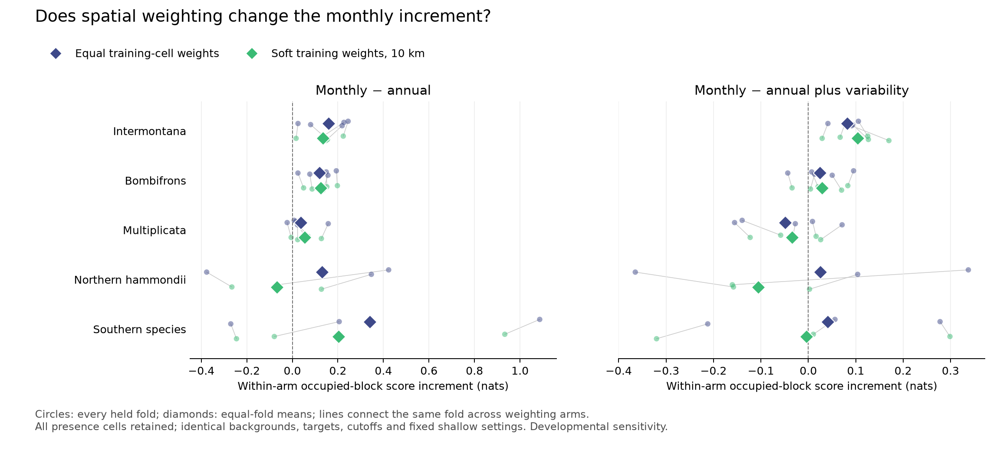
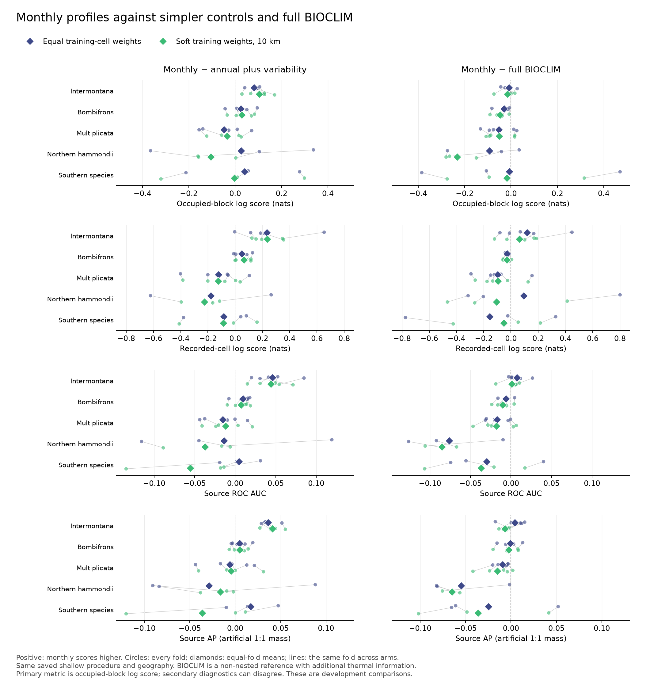

# Climate representation and geographical prediction of recorded Spea occurrences

Kevin M. Neal · Public working manuscript · v0.1.0 · 15 October 2026

This snapshot presents the completed climate-representation comparisons through 5 October 2026. It is exploratory research in progress and has not received independent peer review. The main numerical tables can be [recomputed from the supplied aggregate scores](../REPRODUCIBILITY.md); full occurrence-to-model reproduction is not included. Original selected/fallback and later fixed shallow procedures remain distinct.

## Abstract

Annual climate summaries can conceal differences in the calendar distribution of temperature and precipitation, but retaining monthly profiles need not improve geographical prediction. We compared nested annual, annual-plus-variability and monthly representations within five *Spea* fitting units using existing spatial evaluation designs, and included a non-nested full-BIOCLIM reference under matched fixed settings. Weighted presence–background classifiers estimated relative recording density over available physical area. Primary evaluation averaged log relative density equally over occupied geographical blocks and then over held folds; cell scores and source AUC/average precision were secondary. Under the selected/fallback procedure, monthly profiles improved mean primary scores over annual climate in every unit; original fixed-baseline comparisons changed some signs and effect sizes. Gains beyond variability were consistent across intermontana folds, smaller in bombifrons and negative on average in multiplicata. North/South outcomes depended on evaluation weighting and fitting procedure. A matched fixed shallow comparison retained positive intermontana monthly-minus-variability gains in every fold under equal and soft training weights (+0.082/+0.104 nats), but changed northern and southern outcomes. Full BIOCLIM scored higher on the primary mean in all five units under both arms. Intermontana’s monthly-minus-BIOCLIM differences were small (−0.009/−0.015 nats); secondary cell and AUC means instead favoured monthly. BIOCLIM contains thermal descriptors absent from the monthly mean-temperature inputs, preventing a timing-only interpretation of that reference comparison. These developmental results support comparing representations against explicit controls within the prediction task. They establish neither a general optimal representation or effort correction nor breeding phenology, physiological specialization or population connectivity.

## Introduction

A species recorded under similar annual warmth and precipitation can nevertheless encounter different seasonal sequences. Reducing a climate description to annual means may therefore omit information relevant to prediction in new geography. The converse is also possible: a detailed monthly representation can introduce poorly supported features or relationships that a fitted model does not transfer successfully. The useful empirical question is whether the additional representation improves prediction beyond specified simpler controls, rather than whether a map resembles an expected range.

This is an established predictor-design problem. [Watling et al. (2012)](https://pubs.usgs.gov/publication/70041536) compared monthly and BIOCLIM predictors across twelve vertebrates and found no general performance advantage for either representation. Our main contrast is narrower. Annual temperature and precipitation define a two-column control; adding temperature range and precipitation variability defines a four-column control; monthly deviations and precipitation fractions retain the full calendar profile. The latter adds profile shape and calendar position together. Its performance cannot identify a pure timing effect. We separately compare the full 19 BIOCLIM variables as a non-nested reference with partly different thermal information.

*Spea* provides contrasting recorded seasonal environments within a connected research program. Earlier descriptions associate western spadefoot records with cool-season precipitation, bombifrons and multiplicata records with warmer-season precipitation, and intermontana records with both patterns. Similar broad patterns occur in the available landscapes, so these descriptions alone do not establish climatic preference or tolerance. We represent northern *S. hammondii* and the southern operational unit separately as operational fitting units informed by prior genetic evidence; geographic occurrence assignment remains distinct from direct genetic identification. [Neal et al. (2018)](https://doi.org/10.1007/s10592-018-1066-7) provides the original genetic and niche context for that distinction.

Biological interpretation requires additional evidence. Intermontana larval thermal performance has been studied experimentally alongside distribution models ([Gerick et al. 2014](https://doi.org/10.1111/jbi.12261)), and temperature–hydration interactions have been measured through locomotor performance ([Greenberg and Palen 2021](https://doi.org/10.1098/rspb.2020.2273)). Those experiments have different spatial, life-stage and response support from a record-versus-area model. Monthly climate normals do not measure breeding dates, pond hydroperiod, predators or recruitment.

We ask whether monthly profiles improve held geographical recording-density prediction beyond annual climate and two variability summaries within each fitting unit. We describe dependence on evaluation weights and fitting settings, and separately examine additional summaries and training declustering. These are developmental comparisons, conditional on their saved cohorts, landscapes and learner. The purpose is broad geographical allocation of predicted recording density, including sparsely recorded blocks, rather than estimating climatic physiology or explaining a population division.

## Methods

### Occurrence units, climate and available geography

The frozen occurrence preparation preserved source identity, dates, coordinate-support metadata and duplicate/event provenance. All five cohorts inherited the event-year source scope of 1970–2026, as documented in the [dated source preparation](methods.md#observation-and-climate-support), without substituting record-modification dates. A native 30-arcsec recorded climate cell contributed once to the baseline; repeated assertions did not become separate training presences. Five fitting units comprised intermontana, bombifrons, multiplicata, northern hammondii and the southern unit. The North/South fits used 138/453 cells; the later 535-cell southern historical/Baja cohort was not substituted. The biological unit is a fitting premise, not a claim that every record has a genotype assignment.

Monthly mean temperature and precipitation totals used the aligned CHELSA 2.1 1981–2010 climatological normals. They describe variation across twelve average months, not interannual or daily variation. Records from the wider event-year scope were associated with this one normal period; occurrence-year weather and stationarity across those decades were not tested. Available landscapes and native physical-area weights were inherited without optimization in this comparison. They are pragmatic contemporary comparison domains, not measured dispersal envelopes or historical accessibility. Source masks and their independent clipping are retained in the saved configuration and [background assessment](methods.md#available-geography-and-geographic-assignment).

**Table 1. Saved cohorts and evaluation designs.** Recorded cells describe the accepted baseline cohort; held cells describe the prediction comparison. Train ranges are per outer fold. The designs do not supply a common cross-species performance or specialization scale.

| Unit | Recorded cells | Held cells | Folds; uncertainty-adjusted guard | Training cells per fold | Selection support |
|---|---:|---:|---|---:|---|
| Intermontana | 709 | 505 | 5; 50 km | 249–337 | All four eligible inner folds |
| Bombifrons | 1,611 | 1,199 | 5; 50 km | 634–716 | All four eligible inner folds |
| Multiplicata | 2,012 | 1,619 | 5; 50 km | 816–985 | All four eligible inner folds |
| Northern hammondii | 138 | 138 | 3; 30 km | 72–91 | Two eligible inner folds |
| Southern hammondii | 453 | 453 | 3; 30 km | 98–411 | Two, one and one; last two outer folds use fallback |

Intermontana's descriptive 709 cells and its 703 in-area full-fit cells have separate roles; six described cells lie outside its primary available mask. The seasonal held comparison uses 505 cells after its inherited support rules. The other three-fold design evaluates all North/South cells. Neither held count is an estimate of independent ponds, animals or populations. The [21-row fold-support table](../data/original/support_by_fold.csv) retains training cells, held cells, blocks containing held recorded cells, target counts/areas and the monthly marginal-support diagnostic.



**Figure 1. The seasonal study's own saved spatial tasks.** Colours locate held native targets by fold, aggregated for display to the fold with largest physical area in each 25-km tile. Circles group all 3,914 held recorded cells at the same grain. Pale gray shows the saved primary native available domain for the five-fold species, and the union of saved training/held domains for North/South. Panel extents differ and fold numbers are local to each design. The source masks retain finer geometry; this coarse display can hide narrow guard gaps or mixed-fold tiles. No native fold membership, target area or biological boundary changed.

### Nested representations and model fitting

The annual family contained equal-month mean temperature and log(1 + total annual precipitation). The variability family added warmest-minus-coldest monthly mean temperature and the population coefficient of variation of monthly precipitation. The monthly family added twelve temperature deviations from the annual mean and twelve monthly fractions of annual precipitation, for dimensions 2/4/28. Redundant sum constraints were retained. All definitions were deterministic, and common columns shared training-only numerical cutoffs.

Models used native weighted CatBoost binary cross-entropy. Recorded-cell weight summed to the number of training cells; area/inclusion-weighted landscape weight had the same total. Background locations were quadrature for available physical area, including recorded locations, rather than verified absences. The inherited five-fold design sampled up to eight non-recorded cells per 25-km stratum; the North/South design used up to sixteen. Forced training recorded cells had inclusion probability one. Landscape weights were physical cell area divided by inclusion probability. A buffer excluding recorded neighbourhoods from this integration would change the reference landscape; it is distinct from a guard separating training and held support.

Four fixed candidates varied tree count, depth and effective leaf damping. Selection maximized the mean inner occupied-block log relative-density score and required at least two eligible inner splits, each with twenty training cells and three occupied validation blocks. Every candidate had to complete all eligible splits. The predefined baseline was retained if selection support was insufficient. All eligible unit/family choices selected 150 depth-two trees, learning rate 0.03 and leaf damping 0.03 times presence mass. Six southern family/fold slots used the 300-tree, depth-four baseline with learning rate 0.05 and damping 0.005 times presence mass. Matched fixed baseline results were also saved; outer scores did not select a final representation.

### Geographic evaluation and score

The five-fold units retained globally anchored 150-km tile folds and 50-km support clearance. North/South retained their existing paired three-fold geography and 30-km clearance. Guards accounted for known coordinate-support radii and source-to-cell displacement. The five-fold design used the inherited 1-km unknown-radius training scenario and a held core eligible under the 5-km scenario; North/South used their inherited 1-km scenario. Known uncertainty was not converted to zero or capped. Presences, quadrature and held geography were shared across families within each unit. Spatially separated evaluation follows established principles ([Valavi et al. 2019](https://doi.org/10.1111/2041-210X.13107)); our custom saved splits were not an execution of the blockCV package.

For model margin $`\eta_i`$ at held recorded cell $`i`$, and physical area $`a_j`$ at every complete native cell $`j`$ in its held target, the log relative recording-density score was

```math
\ell_i=\eta_i-\log\left(\frac{\sum_j a_j\exp(\eta_j)}{\sum_j a_j}\right).
```

Zero corresponds to uniform density per available physical area. The primary score averaged recorded-cell log scores within each occupied 50-km block, then equally over blocks and folds. The secondary score averaged cells within a fold, then equally over folds. In sampling terms, the primary target chooses a fold uniformly, then a block containing accepted recorded cells uniformly within that fold, then a recorded cell uniformly within that block. The secondary target chooses a fold and then a recorded cell uniformly. Broad geographical allocation is the declared primary utility; neither target estimates survey effort. Blocks in different folds need not have identical overall weight because fold block counts differ. Baseline training still uses equal recorded-cell weights. Normalization used complete held native landscapes, not only sampled background rows. Each held target has its own normalization: scores assess allocation within held geography, not total recording abundance calibrated between regions.

Secondary ROC AUC and average precision used block-weighted recorded cells and area-weighted landscape, each with total mass one. Average precision therefore describes an artificial 1:1 source mixture. Neither metric is occupancy calibration. Log relative density was the selection criterion because allocation of very low recording density carries a penalty that rankings alone can obscure. The wider project had already inspected these folds and evaluated other representations, observations and geography. Within the reported runs, inner selections were frozen before outer evaluation; choosing and emphasizing questions across the project was not independently locked against fresh outer evidence. All folds had already contributed to development and inspection. We retain every fold and both scoring targets without treating them as independent confirmatory replicates or deriving significance from their signs.

### Separate representation and sampling sensitivities

Later analyses used one fixed shallow setting across the same 21 unit/fold combinations. Five families compared 19 BIOCLIM variables, BIOCLIM plus fourteen summaries, eighteen compact summaries, the 28-column monthly family and monthly plus summaries. The additions included normalized medians, IQRs, skewness, precipitation concentration/entropy, circular wettest/driest three-month shares, annual harmonics and precipitation-weighted temperature offset. They are deterministic transformations of monthly normals, not additional weather observations. The primary annual-only and annual-plus-variability controls were absent from these sensitivities.

Training-only 5/10-km thinning used WGS84 cell-centre distance and ten seeded maximum-neighbour-degree removal attempts per distance; the largest retained set was frozen before fitting. A subsequent 2-km follow-up tested only BIOCLIM and monthly families. Held records and physical-area integration remained unchanged, including integration locations at discarded positive cells. No size-matched random deletion control separated sample-size and geographical effects.

A separate soft weighting retained every training presence at positive weight. Raw weight was the reciprocal of one plus the sum of neighbouring linear tapers, each $`\max(1-d_{ij}/10\text{ km},0)`$, then normalized to original presence mass. It followed the inspected enmSdmX implementation. Backgrounds, cutoffs and effective damping stayed matched. A 10-km support is one declared sensitivity, not inferred effort, dispersal or an optimal bandwidth. Full definitions and outcomes remain in the [feature/sampling report](methods.md#additional-summaries-and-sampling-sensitivities), [2-km follow-up](methods.md#additional-summaries-and-sampling-sensitivities) and [soft-weight report](methods.md#additional-summaries-and-sampling-sensitivities).

A matched representation-by-weighting sensitivity additionally compared annual, variability and monthly families under equal recorded-cell weights and the same frozen soft weights. All 21 folds, presence cells, quadrature, held targets and common-column cutoffs remained matched. It added 84 annual/variability fits and reused 42 monthly fits after source/settings checks, using the same fixed shallow settings throughout. Its primary interaction was the monthly-minus-variability score contrast under soft weights minus that contrast under equal weights, computed within each held fold before equal-fold aggregation. This extends the soft-weight test; the hard-thinning studies still lack those matched controls. It does not retune the earlier selected/fallback pipeline. [Frozen methods and results](../data/README.md#matched-fixed-shallow-comparison).

### Full BIOCLIM as a matched non-nested reference

A saved-fit synthesis joins the matched annual/variability/monthly results to all 42 existing full-BIOCLIM equal/soft-weight fits. Its 168 slots use the same 21 folds, original presence/background/held support, fixed shallow procedure, seeds, presence mass and effective damping. Source split receipts, settings, feature order, counts and frozen weighting vectors were reconciled from saved metrics and small fit metadata; no model was refitted. Within each unit/fold/arm we calculate monthly-minus-BIOCLIM alongside monthly-minus-variability, then average folds equally and preserve every fold and all four score metrics.

The BIOCLIM family reads the nineteen existing CHELSA 2.1 provider rasters, with log(1 + x) for BIO12/13/14/16/17/18/19. Annual/variability/monthly instead derive from twelve mean-temperature and twelve precipitation normals. BIOCLIM includes diurnal and minimum/maximum-temperature descriptors absent from these monthly mean-temperature inputs. The four-column range of monthly means is therefore not BIO07. This reference changes representation, dimension and some thermal information; it cannot isolate calendar timing, compression or a particular thermal mechanism. [Primary variable definitions](https://www.worldclim.org/data/bioclim.html); [CHELSA descriptions](https://www.chelsa-climate.org/datasets); [saved input lineage and scores](../data/README.md#matched-fixed-shallow-comparison).

### Intermontana saved-score attribution

We interpreted the matched fixed shallow intermontana predictions without fitting further models. Every native held-landscape cell was classified by the sign of the existing precipitation-weighted temperature offset: cooler-month versus warmer-month precipitation association, retaining exact zero separately. For each model, physical-area integration supplied its probability mass in each category and a separate within-category density normalizer. The monthly-minus-variability held-cell log score decomposed exactly into the log ratio of category masses plus its within-category density-score increment. Both contributions retained the original evaluation weights; category means conditioned those weights rather than recomputing equal-block weights after subsetting.

A secondary partition used inside versus outside any of the 28 monthly feature marginal ranges at the saved training quadrature locations, including forced training presences. Its mask was common to both representations and training-weight arms. This reference is not a census of training availability, and the marginal flag is not a test of joint support. The [public decomposition tables](../data/README.md#saved-score-decomposition) retain fold, stratum and mean contributions; the original native reconstruction checks are described separately from public replay.

## Results

### Added monthly information differs within the tested units

All five within-unit mean primary monthly-minus-annual contrasts were positive under the selected/fallback procedure (Table 2; Figure 2). The added monthly gain beyond annual-plus-variability was consistent for intermontana under the selected procedure: a mean gain of +0.082 nats, positive in all five folds, with +0.159 over annual alone. Bombifrons gained +0.120 over annual, but variability already supplied most of that increase; the additional +0.025 monthly gain was positive in four of five folds. Multiplicata gained +0.036 over annual, yet its variability representation exceeded monthly by 0.048 nats on average. Its monthly-minus-variability contrast was positive in two of five primary folds and one secondary cell-weighted fold.

**Table 2. Within-unit selected/fallback results.** Scores and paired changes are equal-fold means in nats. Positive folds refer to monthly minus variability. Monthly ROC/AP are secondary source metrics; full family/fold values and fixed results are in the [saved tables](../data/README.md). Different landscapes and designs prevent ranking these rows as species' specialization or model difficulty.

| Unit | Annual | Variability | Monthly | Monthly − annual | Monthly − variability; positive folds | Monthly ROC AUC | Monthly AP, 1:1 |
|---|---:|---:|---:|---:|---|---:|---:|
| Intermontana | +0.204 | +0.281 | +0.363 | +0.159 | +0.082; 5/5 | 0.748 | 0.706 |
| Bombifrons | +0.281 | +0.377 | +0.401 | +0.120 | +0.025; 4/5 | 0.751 | 0.714 |
| Multiplicata | +0.117 | +0.201 | +0.153 | +0.036 | −0.048; 2/5 | 0.673 | 0.647 |
| Northern hammondii | −0.087 | +0.019 | +0.044 | +0.131 | +0.026; 2/3 | 0.658 | 0.634 |
| Southern hammondii | −0.939 | −0.532 | −0.466 | +0.473 | +0.066; 2/3 | 0.658 | 0.644 |



**Figure 2. Paired seasonal-representation changes within units.** A/B show primary occupied-block changes; C/D show secondary equal-cell changes. Circles show all five or three held folds and diamonds their equal-fold mean. Panels preserve different contrast scales; neither points nor their spread are confidence intervals. The dashed separator distinguishes different fold/guard designs; South includes declared baseline fallbacks. The two annual-controls are nested within the monthly representation, which adds both profile shape and calendar position.

Intermontana's secondary monthly-minus-variability mean was +0.233 nats with four folds positive and one small loss. Its source ROC AUC increased 0.671→0.702→0.748 across annual, variability and monthly; AP increased 0.617→0.669→0.706. Bombifrons showed broadly agreeing secondary changes. Multiplicata's secondary mean also favoured variability over monthly (−0.121 nats monthly-minus-variability).

### The original fixed baseline changes some conclusions

The saved original fixed baseline directly qualifies the primary representation result (Table 3). It is the 300-tree, depth-four baseline, distinct from the later 150-tree, depth-two fixed shallow sensitivity. Selection changes multiplicata's monthly-minus-annual mean from −0.039 to +0.036, and South's monthly-minus-variability from −0.269 to +0.066. Intermontana retains a positive mean beyond variability under both procedures, but the positive-fold count is 5/5 selected versus 3/5 fixed. Bombifrons's corresponding counts are 4/5 and 2/5.

**Table 3. Original matched procedure contrasts.** Primary equal-fold means in nats; parentheses count positive folds. Fixed here denotes the original deeper baseline, not Figure S1's fixed shallow controls. All original fixed/selected folds and secondary results remain in [procedure_contrasts.csv](../data/original/procedure_contrasts.csv). No procedure was retrospectively adopted for its more favourable outer result.

| Unit | Selected/fallback monthly − annual | Fixed baseline monthly − annual | Selected/fallback monthly − variability | Fixed baseline monthly − variability |
|---|---:|---:|---:|---:|
| Intermontana | +0.159 (5/5) | +0.193 (3/5) | +0.082 (5/5) | +0.170 (3/5) |
| Bombifrons | +0.120 (5/5) | +0.149 (5/5) | +0.025 (4/5) | +0.018 (2/5) |
| Multiplicata | +0.036 (4/5) | −0.039 (1/5) | −0.048 (2/5) | −0.031 (2/5) |
| Northern hammondii | +0.131 (2/3) | +0.841 (3/3) | +0.026 (2/3) | +0.774 (3/3) |
| Southern hammondii | +0.473 (3/3) | +0.231 (3/3) | +0.066 (2/3) | −0.269 (1/3) |

Northern fixed-baseline gains are large while its absolute monthly primary mean is −0.695, compared with +0.044 under selection. Relative improvement and successful allocation are different outcomes. These contrasts tie effect size, sign and fold consistency to the fitted procedure; they do not replace the declared selection rule.

### North/South results expose evaluation and procedure dependence

Northern hammondii's primary monthly-minus-annual gain was +0.131 nats in two of three folds, while the secondary equal-cell change was −0.239. Monthly's primary mean was +0.044, and one fold remained below uniform. Its monthly ROC AUC slightly exceeded annual (0.658 versus 0.653), but AP declined (0.634 versus 0.648). A ranking improvement therefore did not remove the allocation or weighting limitations.

The southern selected/fallback primary monthly-minus-annual gain was +0.473 nats in all three folds, but absolute monthly scores were +0.442, −1.453 and −0.388. Its overall mean remained below uniform. The largest gain occurred in a fold with nineteen held cells; equal-fold aggregation gave it the same weight as the two larger held sets. Secondary scores favoured variability over monthly, with monthly-minus-variability −0.155 nats rather than the primary +0.066.

The later fixed shallow monthly procedure with equal training-cell weights gave a southern block-weighted mean of +0.083 on the same held regions. Its first fold reproduced the earlier shallow result; the other two had previously used the deeper baseline fallback. Thus the change does not demonstrate improvement from new records, summaries or thinning. The selected/fallback and fixed procedures answer different procedural comparisons. The subsequent matched equal/soft-weight comparison below retests the increment under fixed shallow settings. Hard thinning and the full selected/fallback intervention pipeline still lack matched annual/variability controls.

### Environmental support qualifies the held task

For monthly features, the saved held-cell fraction exceeding at least one training-background marginal range spans 24.1–92.5% across North folds and 0.9–87.4% across South folds. One intermontana fold has 53.7%, while the bombifrons/multiplicata maxima under this diagnostic are 1.3%/0.7%. These descriptions do not explain performance differences. More columns create more opportunities for a marginal flag; flags do not establish joint support or prove extrapolation caused a loss. No held cell was filtered to improve a result.

### Additional summaries and declustering provide mixed changes

Adding fourteen summaries to the monthly family under fixed equal-cell training changed the primary means by +0.014/+0.018/−0.023 nats for intermontana/multiplicata/bombifrons, and +0.048/−0.112 for North/South (Figure S1). An alternative compact eighteen-column description exceeded monthly in all three North folds (+0.168 mean) but lost on average for intermontana and bombifrons; South's added-summary arms were adverse. The complete family comparisons do not support one universal winner.

Monthly thinning at 5/10 km improved mean primary scores for intermontana (+0.025/+0.056), bombifrons (+0.004/+0.021) and multiplicata (+0.037/+0.050). It reduced North/South training sets substantially and generally worsened their scores. The later 2-km intervention retained about 72% of North/South training cells: North's monthly change was +0.003 and South's −0.020, rather than the larger-radius losses. These results identify sensitivity to the intervention, not an optimal spacing rule.

Soft weighting changed primary monthly means by +0.034/+0.012/+0.047 nats in intermontana/bombifrons/multiplicata and −0.103/−0.034 in North/South. South's secondary change was instead +0.121. Canadian intermontana cells averaged 13.1% of training cells but 7.6% of weighted presence mass. A modest aggregate gain does not establish that this geographical redistribution corrects effort rather than suppressing a biologically meaningful cluster.



**Figure S1. Fixed-setting sensitivities have their own controls.** A adds fourteen summaries to monthly profiles; B changes training spacing; C retains all training cells with soft distance weights. A/C circles retain every primary fold. B bars show fold extrema rather than uncertainty intervals; markers show means for 2/5/10 km. C also displays the secondary cell-weighted mean. Every intervention is compared with its matched fixed shallow control using equal training-cell weights, not Figure 2's selected/fallback procedure. A/B evaluate block-weighted changes; C distinguishes block and cell evaluation means. Annual-only and annual-plus-variability families were absent from these initial sensitivities. The following matched equal/soft-weight experiment supplies those controls for one fixed shallow procedure; hard thinning remains outside it.

### Matched weighting preserves some representation contrasts and reverses others

Under the matched fixed shallow procedure, intermontana’s monthly-minus-variability gain remains positive in all five primary folds under both equal and soft training weights (+0.0820/+0.1037 nats; Table S1, Figure S2). Its secondary mean is +0.2330/+0.2350, with four/five positive folds respectively. Monthly-minus-annual remains positive in all five primary folds, although its mean decreases from +0.1591 to +0.1339. An increase in the gain over variability therefore does not imply a larger gain over every simpler representation.

Bombifrons retains a small positive mean increment beyond variability (+0.0246/+0.0289; 4/5 positive under both arms), and multiplicata retains a negative mean (−0.0485/−0.0343; 2/5). Northern hammondii reverses from +0.0256 to −0.1052 (2/3→1/3 positive). The southern mean moves from +0.0407 to −0.0036 despite two positive folds in each arm; a large loss in the third fold offsets the positive folds. This near-zero average is not an equivalence result. Southern secondary increments remain adverse (−0.0851/−0.0873), and its mean source AUC/AP increments also reverse.

**Table S1. The matched monthly-minus-variability contrast and its weighting interaction.** All values are equal-fold means in nats. Parentheses count positive representation contrasts; the final column is the change in the secondary increment. Fixed shallow settings are used in every fold, including South’s formerly deeper fallback folds. These are distinct from Table 2’s selected/fallback results.

| Unit | Equal-weight monthly − variability | Soft-weight monthly − variability | Change in increment | Secondary cell change |
|---|---:|---:|---:|---:|
| Intermontana | +0.0820 (5/5) | +0.1037 (5/5) | +0.0217 | +0.0019 |
| Bombifrons | +0.0246 (4/5) | +0.0289 (4/5) | +0.0043 | +0.0146 |
| Multiplicata | -0.0485 (2/5) | -0.0343 (2/5) | +0.0142 | -0.0025 |
| Northern hammondii | +0.0256 (2/3) | -0.1052 (1/3) | -0.1308 | -0.0459 |
| Southern hammondii | +0.0407 (2/3) | -0.0036 (2/3) | -0.0442 | -0.0022 |



**Figure S2. The representation comparison under two training-weight procedures.** Circles show every held fold and diamonds their equal-fold mean. Lines connect the same fold across weighting arms. Evaluation remains block-weighted; only training weights change. Left compares monthly with annual and right with annual plus variability, with separate x scales. All original presence cells, backgrounds, targets and cutoffs remain fixed. Fold spread is descriptive, not a confidence interval. Complete family/arm source metrics and within-arm representation contrasts are in the [aggregate tables](../data/README.md#matched-fixed-shallow-comparison).

### Full BIOCLIM has higher primary means; secondary scores can disagree

Full BIOCLIM exceeds monthly profiles on the mean primary score in every fitting unit under both matched training-weight arms (Table S2, Figure S3). This is a within-unit mean ordering, not superiority in every fold. Intermontana’s monthly-minus-BIOCLIM differences are small (−0.0091/−0.0148 nats equal/soft; one/two positive folds out of five), despite monthly profiles outperforming the specified variability control in all five folds under both arms. The small differences do not establish equivalence.

**Table S2. The simple control and full-BIOCLIM reference under matched fixed settings.** Entries are equal-fold mean occupied-block score increments in nats; parentheses count positive folds. Positive means monthly scores higher. The variability comparison is nested; BIOCLIM is a non-nested reference with additional thermal information. All 168 saved family/arm/fold values remain in the [packet](../data/README.md).

| Unit | Weight arm | Monthly − variability | Monthly − full BIOCLIM |
|---|---|---:|---:|
| Intermontana | Equal | +0.0820 (5/5) | -0.0091 (1/5) |
| Intermontana | Soft 10 km | +0.1037 (5/5) | -0.0148 (2/5) |
| Bombifrons | Equal | +0.0246 (4/5) | -0.0289 (0/5) |
| Bombifrons | Soft 10 km | +0.0289 (4/5) | -0.0473 (0/5) |
| Multiplicata | Equal | -0.0485 (2/5) | -0.0526 (2/5) |
| Multiplicata | Soft 10 km | -0.0343 (2/5) | -0.0510 (2/5) |
| Northern hammondii | Equal | +0.0256 (2/3) | -0.0933 (1/3) |
| Northern hammondii | Soft 10 km | -0.1052 (1/3) | -0.2314 (0/3) |
| Southern hammondii | Equal | +0.0407 (2/3) | -0.0067 (1/3) |
| Southern hammondii | Soft 10 km | -0.0036 (2/3) | -0.0176 (1/3) |

Intermontana’s secondary cell-score means instead favour monthly (+0.1182/+0.0612, three positive folds under each arm), as do source AUC means (+0.0074/+0.0011, four positive folds each). Equal-weight AP also favours monthly on average (+0.0041; four positive folds), whereas soft-weight AP favours BIOCLIM in every fold (−0.0064 mean). Northern equal-weight cell scores also reverse the primary mean ordering (+0.0941; one of three folds positive). The declared primary score remains the main comparison. [Every secondary value and fold](../data/matched/contrast_folds.csv) preserves this disagreement; source AP is at artificial 1:1 mass rather than natural prevalence.



**Figure S3. All saved folds and both weighting arms against two controls.** Circles show individual folds, diamonds equal-fold means, and lines pair the same fold across arms. Left: monthly minus variability. Right: monthly minus full BIOCLIM. Each metric row shares its x scale across controls, with different scales between metrics. No confidence interval or independent evaluation is implied.

### Monthly gains include within-setting information and outside-range contributions

The intermontana mean monthly-minus-variability gains (+0.0820/+0.1037 nats under equal/soft training weights) included between-seasonal-setting contributions of +0.0246/+0.0185 and within-setting contributions of +0.0575/+0.0852. Within-setting contributions were positive in all five folds under both arms and accounted for about 70%/82% of the mean gains. This is an accounting identity within two coarse descriptive settings; it does not isolate seasonal timing or explain causal variation.

The 505 held cells included 359 cooler-associated and 146 warmer-associated cells. Within the warmer-associated setting, conditional density scores improved in all five folds under both arms, but overall category scores improved in only two because allocation of model mass could worsen. Within-category gains for the cooler-associated setting were positive in two equal-weight and three soft-weight folds. Neither setting improved uniformly by every score; density-score changes do not establish improved rank-order discrimination.

Restriction to the common monthly training-quadrature marginal ranges left 409 held cells and positive conditional mean gains of +0.0223/+0.0549, positive in four of five folds under each arm. The 96 outside-range cells carried 6.66% of original evaluation weight, averaged equally over folds, but contributed +0.0576/+0.0502 to the original mean contrast—about 70%/48% of its gain. Thus the overall five-positive-fold result does not extend to the inside-range subset. In the original native analysis, all contrasts and per-cell accounting identities reconstructed to numerical precision. The [public aggregate packet](../data/README.md#saved-score-decomposition) retains fold, stratum and mean contributions; individual cell contributions and the held-block map remain outside this snapshot. No new fit or independent validation was added.

## Discussion

### What the seasonal contrast establishes

Under the selected/fallback procedure, annual means omitted predictive information in the mean primary within-unit comparisons. The original fixed baseline reversed some representation signs and fold consistency, so that result is procedure-dependent. Beyond two variability summaries, the result was more differentiated: intermontana's additional monthly gain was consistent across primary held regions under selection, bombifrons gained mostly through variability, and multiplicata's monthly profile did worse than its simpler variability description on average. These are within-unit representation contrasts conditional on a learner and developmental evaluation, rather than a common test of species' ecological specialization.

The monthly family retains annual and variability columns, yet including additional columns can reduce held performance. That outcome concerns the fitted procedure, feature support and finite training data, not an absence of seasonal biology. Conversely, an improvement combines calendar position, shape and the learner's ability to express associations. It cannot isolate a particular breeding month, thermal threshold or causal precipitation response. Added summaries contain no new information relative to their monthly inputs, but can change what a shallow tree model expresses. Their mixed gains reinforce the distinction between ecological information and its statistical representation.

The matched soft-weight comparison preserves intermontana’s monthly increment beyond variability under both tested fixed shallow training procedures. It also preserves bombifrons’s small positive and multiplicata’s adverse mean contrasts, while North/South outcomes change. This resolves the previously missing representation-by-weighting comparison for one declared taper. The saved-score attribution shows that the intermontana gain is not exhausted by reallocating mass between cooler/warmer precipitation settings; its inside-range subset remains positive on average but loses the all-five-fold consistency. Substantial outside-range contributions qualify generalization without establishing an extrapolation mechanism. It does not establish robustness to hard thinning, estimated observer effort, the full inner-selected pipeline or new independent geography. The recorded-density target remains distinct from occupancy or physiological tolerance.

The matched full-BIOCLIM reference now supplies a concrete qualification: monthly profiles add predictive information beyond the specified simple controls for intermontana, but do not improve its mean primary score over full BIOCLIM under either tested weighting procedure. Its cell/AUC disagreement shows why the evaluation target must remain explicit. BIOCLIM’s additional thermal descriptors prevent interpreting the mean advantage as proof that compression helps, calendar information is unnecessary or thermal extremes caused it. No general representation superiority follows. The saved-score attribution concerns monthly minus variability and does not explain the BIOCLIM difference. Watling et al.’s broader monthly/BIOCLIM precedent remains relevant; our findings remain conditional on the actual inputs and procedure.

### Recording and transfer are separate from physiology

One contribution per native cell, area-weighted quadrature and guarded evaluation address specific forms of repetition, integration and leakage. They do not estimate the probability that an occupied pond is visited or reported. Block and cell weighting answer different evaluation questions; agreement is informative, while their reversals deserve interpretation rather than choosing the favourable result. The North/South cohort sizes and southern fallback feasibility are practical information limits. Southern procedure sensitivity particularly argues against attributing poor transfer solely to climate tolerance, a missing habitat variable or the choice of model family.

Temporary-pool availability and breeding conditions remain plausible biological constraints, but this analysis did not measure hydroperiod, predators or recruitment. Existing thermal and hydration experiments supply independent physiological evidence at their own life stages and geography. Neither broad recorded climates nor good prediction in them demonstrates broad physiological tolerance, and neither a weak environmental model nor an improved summary identifies the missing biological mechanism.

### Contribution and further inference

Predictive climate gains do not validate resistance, movement or genetic structure. Those questions require their own matched evidence.

The most useful contribution is a transparent comparative application with simpler controls, geographically held allocation scores and explicit procedure dependence. It supports assessing seasonal representations within the actual prediction problem while preserving null and adverse outcomes. All retained folds were reused developmental geography; independent evaluation, effort information and matched biological observations would strengthen inference. The present evidence does not extend these performance comparisons to adaptation, ancestry or unmeasured pond mechanisms.

## References

Article, dataset and implementation references below support the manuscript and its Methods appendix. [Reference metadata](../metadata/references.json) are included with this snapshot. Watling et al. is cited at primary-abstract level; uninspected full-body methods remain unclaimed.

Neal, K. M., Johnson, B. B., and Shaffer, H. B. (2018). Genetic structure and environmental niche modeling confirm two evolutionary and conservation units within the western spadefoot (*Spea hammondii*). *Conservation Genetics*, 19, 937–946. [doi:10.1007/s10592-018-1066-7](https://doi.org/10.1007/s10592-018-1066-7).

Valavi, R., Elith, J., Lahoz-Monfort, J. J., and Guillera-Arroita, G. (2019). blockCV: An R package for generating spatially or environmentally separated folds for k-fold cross-validation of species distribution models. *Methods in Ecology and Evolution*, 10(2), 225–232. [doi:10.1111/2041-210X.13107](https://doi.org/10.1111/2041-210X.13107).

Watling, J. I., Romañach, S. S., Bucklin, D. N., Speroterra, C., Brandt, L. A., Pearlstine, L. G., and Mazzotti, F. J. (2012). Do bioclimate variables improve performance of climate envelope models? *Ecological Modelling*, 246, 79–85. [doi:10.1016/j.ecolmodel.2012.07.018](https://doi.org/10.1016/j.ecolmodel.2012.07.018); [primary USGS record](https://pubs.usgs.gov/publication/70041536).

Gerick, A. A., Munshaw, R. G., Palen, W. J., Combes, S. A., and O’Regan, S. M. (2014). Thermal physiology and species distribution models reveal climate vulnerability of temperate amphibians. *Journal of Biogeography*, 41, 713–723. [doi:10.1111/jbi.12261](https://doi.org/10.1111/jbi.12261).

Greenberg, D. A., and Palen, W. J. (2021). Hydrothermal physiology and climate vulnerability in amphibians. *Proceedings of the Royal Society B*, 288, 20202273. [doi:10.1098/rspb.2020.2273](https://doi.org/10.1098/rspb.2020.2273).

Karger, D. N., Conrad, O., Böhner, J., Kawohl, T., Kreft, H., Soria-Auza, R. W., Zimmermann, N. E., Linder, H. P., and Kessler, M. (2017). Climatologies at high resolution for the earth’s land surface areas. *Scientific Data*, 4, 170122. [doi:10.1038/sdata.2017.122](https://doi.org/10.1038/sdata.2017.122).

Karger, D. N., Conrad, O., Böhner, J., Kawohl, T., Kreft, H., Soria-Auza, R. W., Zimmermann, N. E., Linder, H. P., and Kessler, M. (2021). *Climatologies at high resolution for the earth’s land surface areas*, version 2.1. EnviDat dataset; 1981–2010 normals used here. [doi:10.16904/envidat.228](https://doi.org/10.16904/envidat.228).

Prokhorenkova, L., Gusev, G., Vorobev, A., Dorogush, A. V., and Gulin, A. (2018). CatBoost: unbiased boosting with categorical features. *Advances in Neural Information Processing Systems*, 31. [Official proceedings](https://proceedings.neurips.cc/paper/2018/hash/14491b756b3a51daac41c24863285549-Abstract.html).

Aiello-Lammens, M. E., Boria, R. A., Radosavljevic, A., Vilela, B., and Anderson, R. P. (2019). *spThin: Functions for Spatial Thinning of Species Occurrence Records for Use in Ecological Models*, version 0.2.0. Package date 14 November 2019; manual generated 9 May 2026. [Official manual](https://cran.r-project.org/web/packages/spThin/spThin.pdf). Algorithm context; the R package was not executed.

Smith, A. B. (2025). *enmSdmX: Species Distribution Modeling and Ecological Niche Modeling*, version 1.2.11. [Official repository](https://github.com/adamlilith/enmSdmX). The inspected distance-weight formula was translated to Python; the R package was not executed.

Commission for Environmental Cooperation (2021). *North American Environmental Atlas: Terrestrial Ecoregions Level III*, Edition 2.0. [Official dataset](https://www.cec.org/north-american-environmental-atlas/terrestrial-ecoregions-level-iii/). Attribution also to Agriculture and Agri-Food Canada, US EPA, INEGI, CONABIO and INECC; exact source objects are listed in the Methods packet.

Natural Earth (n.d.). *Natural Earth 1:10m land*. [Official dataset](https://www.naturalearthdata.com/downloads/10m-physical-vectors/10m-land/). Accessed 4 October 2026; saved source bytes identify the independent mainland asset.

Rose, J. P., Halstead, B. J., Packard, R. H., Ochoa, J. E., Rochester, C. J., and Fisher, R. N. (2025). *Occurrence Data for the Western Spadefoot (Spea hammondii) in Southern California From 1995 to 2020 and Projected Species Distribution Model*. USGS data release. [doi:10.5066/P9O7MC7M](https://doi.org/10.5066/P9O7MC7M). One contributing source; the full cohort draws on additional frozen providers.

WorldClim (n.d.). *Bioclimatic variables*. [Provider definitions](https://www.worldclim.org/data/bioclim.html). Accessed 5 October 2026; definition reference, not a source of the fitted rasters.

CHELSA (n.d.). *Dataset search and variable descriptions*. [Official descriptions](https://www.chelsa-climate.org/datasets). Accessed 5 October 2026; fitted inputs are the frozen 2.1 1981–2010 provider rasters identified in the Methods and lineage packet.
