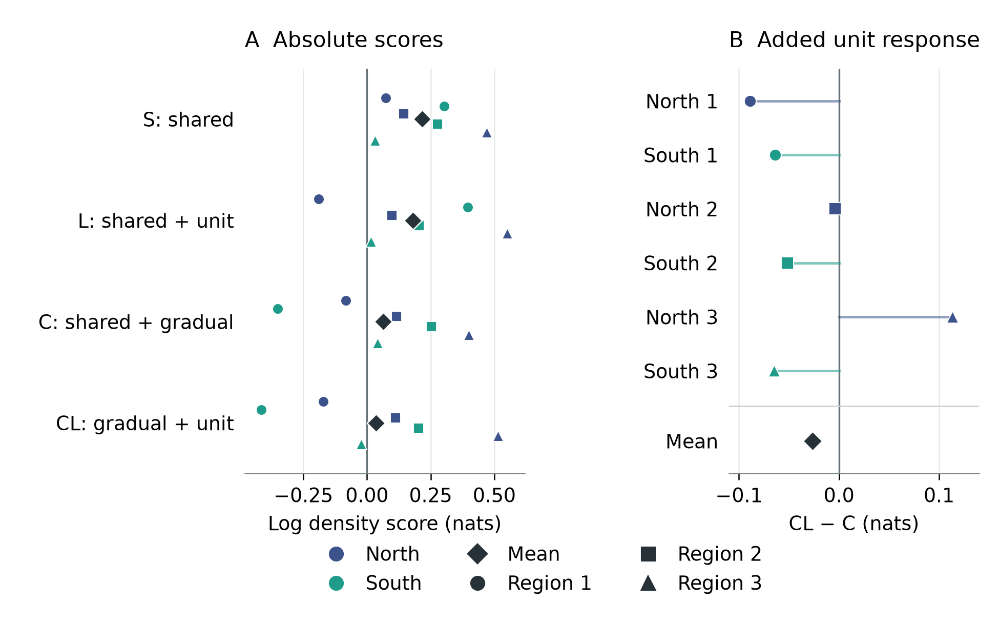
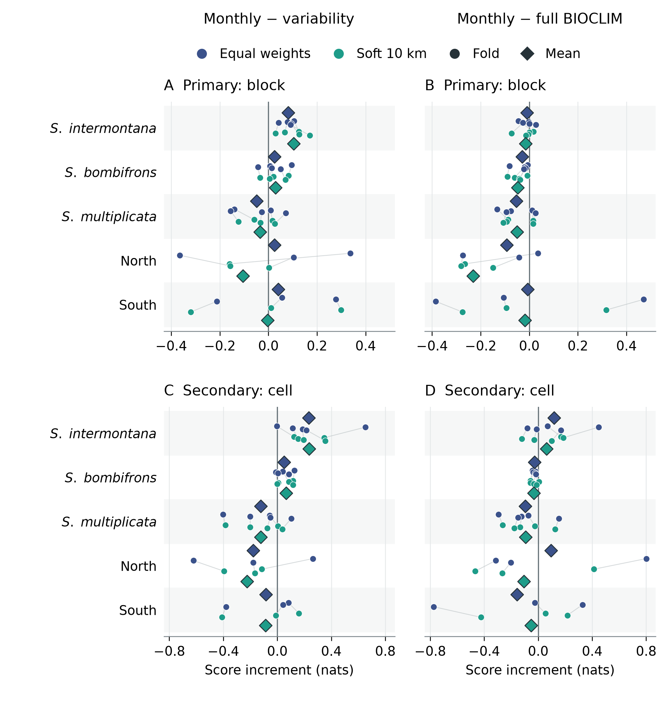
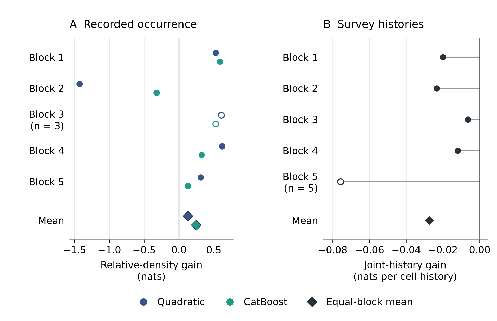
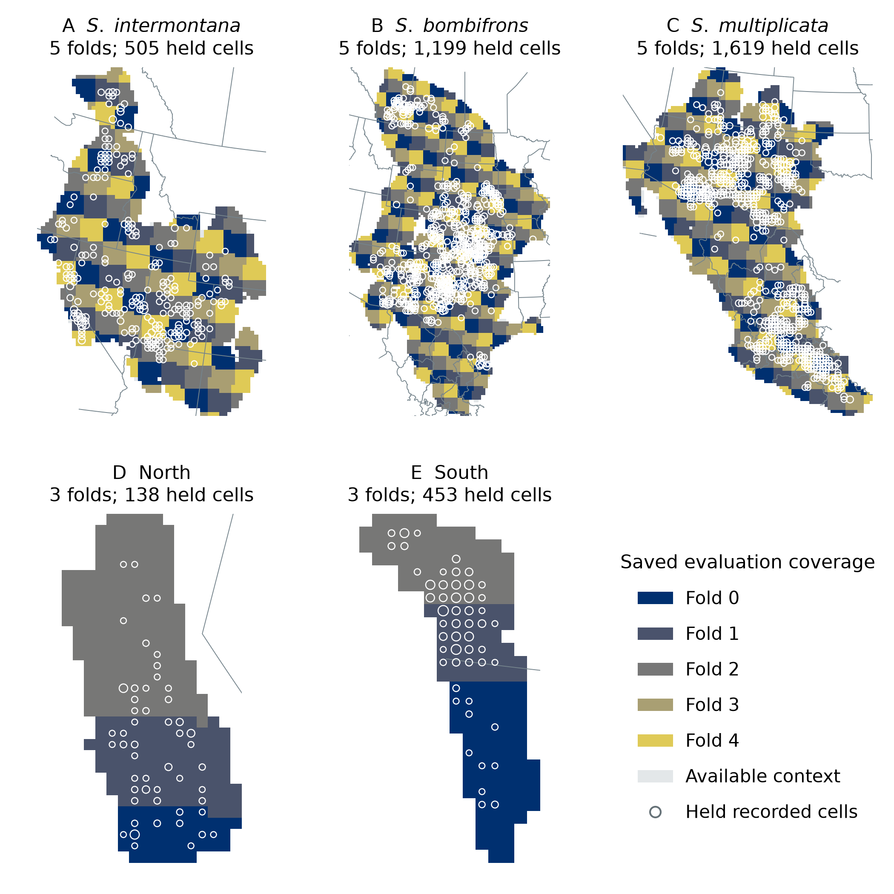

# Recorded climatic differences and geographic prediction across Spea

Kevin M. Neal

Working manuscript 29 October 2026

## Abstract

Geographic differences in recorded climate can motivate hypotheses of ecological differentiation, but their predictive value also depends on available environments, model representation and observation processes. We assembled three complementary analyses of North American spadefoots (*Spea*) to examine these dependencies. First, northern and southern western spadefoot records differed climatically, yet adding separate climatic responses to a reference that already allowed gradual geographic variation reduced mean held geographic log recording density by 0.027 nats; the increment was positive in one of six group–region evaluations. Its sign changed with source composition and regularization. Second, matched comparisons across five analysis units assessed annual means, simple variability summaries, monthly profiles and the full 19 BIOCLIM variables. For *S. intermontana*, monthly profiles improved the primary score beyond annual means plus variability by 0.082 and 0.104 nats under equal and soft geographic training weights, respectively, with positive increments in all five folds. Full BIOCLIM nevertheless had the higher primary mean in all five units under both weight schemes, with disagreements under secondary evaluation weights. Third, mapped-water distances improved southern occurrence-density prediction in four of five spatial blocks for two fixed models, but slightly worsened a separate survey-history comparison in every block. The latter comparison used different observations, habitat controls and likelihoods, precluding attribution of the discrepancy to effort alone. These developmental comparisons establish conditional predictive findings without identifying intrinsic ecological responses. They show where recorded climatic contrasts, added environmental detail and plausible habitat proxies provide useful prediction, and where stronger ecological interpretation requires evidence beyond the distribution records.

Keywords: climatic association; geographic transfer; presence-background models; seasonal climate; spadefoot toads; survey histories

## Introduction

Climatic differences among recorded distributions are relevant to ecological and evolutionary questions, but several processes can produce them. Populations may respond differently to the same conditions, may encounter different available environments, or may be observed through different collection and reporting processes. Presence-background models compare recorded locations with a specified landscape, and therefore depend on both environmental availability and the process generating records (Phillips et al., 2009; Elith et al., 2011). A difference between fitted distributions is consequently distinct from evidence that separate responses improve prediction in geographically held data. Evaluating that distinction is useful even when the biological groups themselves are independently established.

Western spadefoots provide such a case. Neal et al. (2018) reported genetic structure and differentiated niche models for northern and southern units within *Spea hammondii* sensu lato. Those findings motivate a further question: does adding a discrete North/South climatic response improve geographic prediction after accounting for available environments and specified gradual geographic variation? A predictive comparison addresses a different target from the earlier niche-identity test. It neither supplies a new genetic assessment nor makes biological identity contingent on model performance.

The wider genus offers a related question about climatic representation. *Spea intermontana*, *S. bombifrons*, *S. multiplicata* and the two western spadefoot units occur across different rainfall and temperature regimes. Annual climate summaries may omit predictive information carried by monthly profiles, but more detailed coordinates can also change how a learner represents an association without identifying a biological mechanism. Monthly versus BIOCLIM comparisons already have a methodological precedent, including an absence of general superiority for either representation in the vertebrate comparison of Watling et al. (2012). An interpretable comparison should therefore include both simple controls and the full BIOCLIM reference, preserve adverse results, and specify the geographic prediction task.

Breeding-water availability is another plausible contributor to spadefoot distributions. A predictor based on proximity to mapped water could improve an occurrence model because it describes suitable habitat, because observations concentrate near known breeding sites, or through associations with other environmental variables. The southern California data assembled by Rose et al. (2025a), associated with the integrated distribution study of Rose et al. (2022), permit complementary occurrence and survey-history comparisons. Their distinct observation units are informative, although they do not form a controlled experiment isolating observation bias.

Here we examine three questions using completed contemporary analyses. Do North/South response terms add geographic predictive value beyond a specified gradual reference? How does the incremental value of monthly climate depend on the comparison representation and training weights within each *Spea* unit? Do mapped-water distances add information in both an occurrence-background comparison and a survey-history comparison with habitat and observation covariates? We retain the different meanings of these comparisons rather than combine their scores into one ecological effect. The study concerns geographically evaluated environmental prediction and the interpretations it can support; it does not estimate physiological tolerance, infer new lineages or reconstruct population history.

## Methods

### Analysis structure and development history

The three analyses use related ecological questions but different samples, models and evaluation targets (Table 1). They were developed sequentially rather than specified together as one prospective experiment. Within the reported runs, designs and fitting rules were fixed before their outcome summaries, and paired comparisons retained their specified observations and available areas. However, the same geographic folds had already contributed to wider development and inspection. We therefore treat the results as developmental evidence, report all relevant folds and consequential sensitivities, and make no significance or equivalence claim from fold counts. The original seasonal selection procedure and the later fixed-setting comparison remain distinct.

**Table 1. Questions and evaluation targets.** A recorded climate cell, a public occurrence point and a surveyed site history are different units. Score changes are interpretable within their own paired comparison; they cannot be pooled across rows.

| Comparison | Observational and geographic support | Primary evaluation target |
| --- | --- | --- |
| North/South response | 138 northern and 453 southern recorded climate cells; three paired geographic regions | Mean log recording density within each group–region, then equal weight to six targets |
| Climate representation | Five units; 21 unit-specific folds, with three or five folds per unit | Equal weight to recorded cells within occupied blocks, then blocks within folds and folds within units |
| Southern mapped water | Occurrences: 324 earlier public points and five source blocks. Surveys: 376 cells with 2,133 surveyed cell-years in five source blocks | Occurrences: equal-block mean log recording density. Surveys: equal-block mean log probability of the complete observed history |

### Records and environmental support

The comparative occurrence preparation retained source identities, event dates, coordinate-support metadata and duplicate relationships. It combined the preserved GBIF query snapshot with eligible published and author-source records. Records were assigned to native 30-arcsecond climate cells, with one contribution per accepted recorded cell in baseline fitting. Repeated assertions therefore did not become additional model presences. The event-year scope was 1970–2026, without implying equal temporal coverage among units. The five descriptive cohorts contained 709 *intermontana*, 1,611 *bombifrons*, 2,012 *multiplicata*, 138 northern and 453 southern western spadefoot cells. The western units follow the established biological premise of Neal et al. (2018); most occurrence assignments are geographic proxies rather than individual genotypes. We use North and South as analysis labels without proposing a taxonomic revision.

All contemporary climate inputs came from CHELSA 2.1 at native resolution, using 1981–2010 normals (Karger et al., 2017, 2021). Monthly inputs were mean air temperature in degrees Celsius and total precipitation in millimetres per month. The nineteen BIOCLIM variables were the aligned provider products. These climatologies describe broad associations across the record period, not weather at observation or demonstrated stationarity over the intervening decades.

Available landscapes were inherited source-informed regional domains based on CEC Level III ecoregions, a 25-km projected transition margin and independent mainland clipping; North/South analyses retained their group-assigned domains. They were not fitted occurrence hulls or estimated dispersal envelopes. Native physical cell areas supplied integration weights. Background cells represented available area, including recorded locations, rather than verified absences. The six *intermontana* descriptive cells outside its primary mask did not enter the 703-cell full-area fit; the seasonal held cohort comprised 505 cells after its separate support requirements. Cohorts and saved evaluation geography are detailed in the supporting information.

### North and South climatic responses

The controlled comparison used BIO05, BIO06, log-transformed annual precipitation BIO12 and precipitation seasonality BIO15, with linear and squared climate terms. All four structures included a geographic main effect. S used a shared climatic response; L added North/South climatic deviations; C allowed climatic responses to vary with a spline of signed distance to the existing geographic separator; CL combined the gradual and North/South deviations. Thus the primary contrast, CL minus C, adds discrete response terms beyond a reference that already contains climate-by-spline interactions. L minus S is a separate secondary contrast.

The primary setting used all eligible sources, the cubic geographic basis, coefficient ridge penalty 1 and a 1-km support scenario for unknown positional uncertainty. Known coordinate-support radii remained uncapped. Three paired held regions comprised whole 50-km blocks, with at least 30-km uncertainty-adjusted separation between training and held records. Training gave equal total weight to North and South and equal weight to cells within each group. We minimized the equal-group mean conditional negative log recording density, with separate North/South area normalizers, plus one-half the stated ridge coefficient times the squared coefficient norm. The geographic spline was a one-dimensional reference, not exhaustive spatial adjustment. Source-restricted cohorts, a 5-km unknown-support scenario, linear geography and ridge 0.1 were retained as sensitivities. No favored alternative replaced the declared primary result after inspection.

A separate pooled and reciprocal-transfer comparison used CatBoost models with climate and optional terrain. Home-unit, opposite-unit and pooled training data predicted common held targets. Its score averaged cells within occupied 50-km blocks, then blocks within targets and targets equally; this differs from the controlled comparison's primary cell weighting. Because pooling changes sample size, geographic coverage and environmental support, it is a practical transfer diagnostic rather than another estimate of the discrete-response effect.

### Climate representation and training weights

Within each of the five analysis units, we compared a two-predictor annual representation, a four-predictor variability representation, a 28-predictor monthly representation and the full nineteen BIOCLIM variables. The annual predictors were mean monthly temperature and log-transformed annual precipitation. Variability added the range of monthly mean temperature and the population coefficient of variation of monthly precipitation. Monthly profiles added twelve temperature deviations and twelve monthly fractions of annual precipitation to those four predictors. This nested contrast adds calendar position and profile shape together. Full BIOCLIM is non-nested and includes diurnal and minimum/maximum-temperature information absent from the monthly mean-temperature inputs.

The main matched comparison used the completed fixed shallow CatBoost procedure: 150 depth-two trees, learning rate 0.03 and effective damping 0.03 scaled by training presence mass. Weighted binary cross-entropy distinguished recorded cells from area-weighted integration rows; positive and background loss masses were equal. The same original presence cells, held targets, quadrature and common-column cutoffs were retained across representations. Equal training weights were compared with one soft geographic taper that reduced weights in locally dense neighborhoods while retaining every presence. Its 10-km support was a declared sensitivity rather than an estimated observer-effort or dispersal scale.

The three broader-ranging species retained five geographically interspersed tile folds with 50-km support clearance; North and South retained three regional folds with 30-km clearance. Each representation was evaluated on the same held support within a unit. We assembled 168 saved family-by-weight-by-fold slots without refitting. The earlier nested selected/fallback procedure, the original deeper fixed baseline and hard-thinning experiments are reported separately in supporting information because their fitting rules or controls differ. They do not become additional biological replicates of the main matched comparison.

### Recording density and evaluation weights

For the controlled response and climate-representation comparisons, model margin η at recorded cell i and physical area a at target cell j defined held log relative recording density as

$$
\ell_i = \eta_i - \log\left(\frac{\sum_j a_j\exp(\eta_j)}{\sum_j a_j}\right).
$$

All logarithms are natural, so log scores and gains are expressed in nats. The normalizer integrated every complete native cell in the same held target. Zero therefore represents uniform recording density per available area, not niche equivalence or an occupancy probability. Targets were normalized separately, so scores assess allocation within held geography rather than recording abundance between regions.

For the controlled North/South comparison, the primary score averaged cells within each group–region and then weighted the six targets equally. For climate representation, the primary score averaged recorded cells within occupied 50-km blocks, blocks within folds and folds within units. Here occupied means containing an accepted record, not independently verified occupancy. The secondary score gave cells equal weight within each fold before averaging folds. These targets emphasize different distributions of records; neither estimates survey effort. Source AUC and average precision were secondary diagnostics, with equal total recorded and background mass and an artificial one-half source prior for average precision. Absolute scores across species with different available landscapes do not rank niche breadth or physiological specialization.

### Southern mapped water and survey histories

The occurrence comparison used 409 public southern California points from Rose et al. (2025a) and 28,880 background points on the existing native-land support. Unlike the native-grid comparisons above, it normalized each model by the unweighted mean of exponentiated margins over its supplied held background points, with equal weight to held occurrences within a block. Its primary evaluation held out each of five source blocks among 324 records dated 1995–2016, excluding training points within 5 km of held public points. Two fixed families, a regularized quadratic model and shallow CatBoost, compared the nineteen BIOCLIM variables with and without two log-transformed distances to mapped ponds/vernal pools and ephemeral streams. A separate 85-record later-period comparison used guarded earlier training records. Those later records had already appeared elsewhere in the project and were not fresh external validation.

The survey comparison used 376 source-keyed cells and annual pitfall histories from 1995–2016: 2,133 surveyed cell-years, including 150 detections, and 6,139 no-trapping years retained as missing. Sixty-eight cells had at least one encounter. A static latent site-use component depended on grass/shrub cover, sand, slope and elevation; an annual encounter component depended on trapping days and water-year precipitation. Water distances were added to that habitat model rather than to BIOCLIM. The model assigned probability to each complete observed history, allowing an all-zero history to represent either no site use or missed encounters. It assumed a static site-use state and conditional annual independence. Its logistic site-use formulation was a separate diagnostic informed by the released USGS implementation, not a reproduction of the integrated model in Rose et al. (2022, 2025b).

We held out the five supplied survey blocks. Their source identities were preserved, but a geometric exclusion gap was not established and survey coordinates were not reconstructed. Scores averaged log history probability within blocks, then blocks equally. These scores have units of nats per cell history and are distinct from occurrence-density scores. Both arms shared observations, habitat and annual covariates, regularization and fitting rules.

## Results

### Recorded North and South climates differed without stable added response benefit

Northern recorded cells had higher median warmest-month maxima than southern cells, 32.7 versus 30.5°C, lower coldest-month minima, 4.1 versus 5.7°C, and greater annual precipitation, 422.5 versus 355.3 mm. Recorded precipitation interquartile ranges nevertheless overlapped, approximately 367–457 and 314–419 mm. The contrast between available-area precipitation medians was larger, 560.9 versus 311.3 mm. These are differences between recorded and available climate distributions, with no direct estimate of intrinsic preference.

Under the primary controlled setting, mean scores were 0.2170, 0.1798, 0.0629 and 0.0362 nats for S, L, C and CL, respectively (Figure 1). The shared climatic response with its geographic main effect had the highest mean and positive scores in all six group–region targets. Adding North/South responses beyond the gradual reference produced a mean CL-minus-C increment of −0.0267 nats, positive in one of six targets and in none of the three southern targets. The L-minus-S increment was −0.0373 nats. The larger C and CL structures also failed to improve upon S on average; the result does not favor gradual variation as an established biological explanation.

The incremental sign was sensitive to source composition and regularization. On the same source-restricted held cohort, ridge-one models trained on all sources gave CL minus C of −0.0230 nats, whereas training on other-source contributors gave +0.0519. In the latter comparison, C and CL both scored below uniform. A positive increment thus did not necessarily identify an adequately predicting group-specific model. Source removal also altered sample size and geographic coverage, preventing attribution of the change solely to observer bias.

Pooling provided a complementary result. In the climate-plus-terrain transfer diagnostic, pooled training outperformed home-unit training in all six primary target comparisons; mean home-minus-pooled gain was −0.6724 nats. Home-unit training outperformed opposite-unit training in three of six comparisons, with a mean increment of +0.0133. Pooling's practical benefit coexisted with unresolved climatic-response differentiation because it changed both available training information and environmental support.

### The value of monthly profiles depended on the reference and evaluation target

For *intermontana*, the matched equal-weight annual, variability and monthly primary means were 0.2040, 0.2810 and 0.3631 nats. Monthly profiles exceeded annual means plus variability by 0.0820 nats under equal training weights and 0.1037 under soft geographic weights, positive in all five folds in each arm (Figure 2). This supplied the most consistent monthly increment over the simple controls across the retained folds of the tested procedure. In *bombifrons*, the corresponding means were smaller, +0.0246 and +0.0289, with four of five folds positive. In *multiplicata*, variability exceeded monthly on average under both weights, with monthly-minus-variability means of −0.0485 and −0.0343.

Full BIOCLIM had the higher primary mean than monthly in all five units under both training-weight schemes. The *intermontana* differences were small: monthly minus BIOCLIM was −0.0091 and −0.0148 nats, with positive increments in one and two of five folds, respectively. This was a within-unit mean ordering, not dominance in every fold or evidence that BIOCLIM was an optimal representation. BIOCLIM also carries different thermal information, so the contrast cannot isolate the contribution of calendar timing or compression.

Secondary weighting changed some conclusions. For *intermontana*, monthly minus BIOCLIM was +0.1182 and +0.0612 nats under equal-cell evaluation for the two training arms, reversing the primary mean ordering. The northern equal-training-weight comparison also reversed that ordering under cell evaluation. These disagreements concern different weighting of the same records. They are not resolved by selecting whichever metric favors one representation.

The northern and southern monthly increments beyond variability changed sign under soft weighting: +0.0256 to −0.1052 nats in North, and +0.0407 to −0.0036 in South. Fitting procedure mattered independently. South's original selected/fallback monthly mean was −0.4662, while the later fixed-shallow equal-training-weight mean was +0.0830 on the retained evaluation support. Two original southern folds had used a deeper fallback because inner selection support was insufficient. The later procedure therefore qualifies interpretations of poor prediction; it is not a retrospective replacement for the original result. Supporting information preserves these procedures and the deeper fixed baseline separately.

### Mapped water improved the occurrence comparison but not the survey comparison

Adding mapped-water distances to climate improved the occurrence-density primary mean from 0.161 to 0.288 nats in the quadratic model and from 0.238 to 0.487 in CatBoost. Paired mean increments were +0.127 and +0.249, respectively, with four of five source blocks improving under each family (Figure 3). Both models deteriorated in block 2. Block 3 contained only three earlier records; descriptively omitting it reduced the mean increments to +0.008 and +0.180. Those omissions expose influence without replacing the primary results. The guarded later-record comparison also favored adding water, but was not an independent external test.

In the survey-history comparison, adding the same types of distance proxies to terrestrial habitat and annual effort/rain covariates reduced the equal-block mean score from −1.1941 to −1.2216 nats per cell history. The increment was −0.0275, with losses in all five blocks; the pooled-cell increment was −0.0155. The smallest block contained five cells. Omitting it descriptively left a mean increment of −0.0154, retaining the negative direction.

The survey loss concerned mainly prediction of which cells had any encounter, rather than the conditional annual pattern. Negative full-data distance coefficients did not translate into improved held histories. Because the two water comparisons also differed in sample, baseline covariates, likelihood and held geography, their contrast did not identify observation effort as the cause of occurrence-based gains. Neither measured pool hydroperiod, predator exclusion or reproductive success.

## Discussion

### Climatic contrasts and predictive response differences are separate findings

The North/South results retain a biological distinction while qualifying one environmental interpretation of it. Recorded climates differed, but discrete response terms did not consistently improve geographic prediction under the controlled reference. That comparison did not repeat the niche-identity test of Neal et al. (2018), and a negative increment is not evidence that the units share identical niches. The result instead states that the additional terms lacked stable predictive utility in these data, available environments and response families. The strong environmental-availability contrast, limited common support, source dependence and regularization sensitivity remain alternative explanations for the observed patterns.

The shared model's advantage also does not establish a single common physiological response. A lower-dimensional model can predict better because it estimates fewer parameters from uneven data. Conversely, a positive increment between poorly transferring models need not identify a biologically useful distinction. The transfer comparison reinforces that practical point: pooling enlarged training information and often improved prediction, while the benefit of home-unit over opposite-unit training was inconsistent. These results address model allocation of recorded density, not the validity of genetically supported units or their conservation significance.

### More detailed climate does not identify a seasonal mechanism

The matched *intermontana* result demonstrates that annual means and two variability summaries omit information useful to the specified prediction procedure. Monthly profiles add both calendar position and waveform shape, expressed through many coordinates that a shallow tree model can use. Their gain cannot be assigned solely to rainfall timing, breeding phenology or a physiological response. The smaller *bombifrons* increment and adverse *multiplicata* contrast further argue for evaluating representation within a particular task rather than assuming that finer seasonal detail is uniformly beneficial.

The full-BIOCLIM reference is consequential: it prevents presenting the simple-control comparison as evidence of general monthly superiority. Its primary mean advantage across all ten unit/weight combinations is compatible with the absence of a universal representation advantage reported by Watling et al. (2012). It does not establish a general BIOCLIM recommendation either. The secondary reversals and the differing thermal inputs show that representation choice and evaluation utility are inseparable from the result. Existing thermal and hydrothermal experiments on *intermontana* examine organismal performance directly (Gerick et al., 2014; Greenberg and Palen, 2021); geographic recording scores cannot replace those endpoints.

### Water proxies require interpretation within the observation design

Mapped-water distances had useful predictive value beyond climate in the southern occurrence benchmark, with a substantial regional failure and sensitivity to a sparse block. The survey comparison asked a different incremental question and found no benefit beyond its habitat and annual observation covariates. The pair therefore supplies a stronger qualification than either result alone: distance to mapped water was not a consistently helpful addition across the tested observation/model settings. It does not show that breeding water is unimportant or that effort adjustment removes a causal water effect.

Mapped ponds and streams incompletely describe the water environments available to spadefoots. Timing, persistence, management, temperature and predators can matter without being captured by distance. Targeted surveys and compiled occurrences also sample landscapes differently, while the survey model's static site-use state across 22 years is a strong assumption. These limits explain why a useful proxy comparison leaves the larger biological question open. An estimate of population response would require linked biological exposures and outcomes, not merely a more detailed climatology or another distance layer.

### Interpretation and scope

The contribution is a comparative account of where added distinctions improve geographic prediction and where their value depends on the reference and recording design. The analyses provide no pooled test of ecological differentiation. Their common lesson is supported by specific outcomes: recorded North/South climatic differences did not yield stable added-response gains; monthly detail improved some comparisons but lost to the full reference on the primary mean; and a plausible habitat proxy helped one design while failing to improve another. These findings are relevant to selecting and interpreting environmental models for *Spea*, even though they do not identify adaptation or population history.

The main limits are observational and procedural. Recorded-cell aggregation, physical-area integration, spatial separation and geographic weighting address specified forms of repetition and evaluation leakage, but do not estimate the probability that an animal or pond is visited and reported. Available domains remain modeling choices. Climate normals are temporally coarser than biological exposures. Fold reuse and iterative development limit confirmation, and the score changes depend on the declared response families. We therefore preserve the full fold results and consequential adverse comparisons without treating additional model complexity as stronger biological evidence. The completed study supports these conditional predictive conclusions; intrinsic ecological differentiation remains a distinct evidential question.

## Data and code availability

The public [spea-climate-research companion](https://github.com/kevinmneal/spea-climate-research), version 0.3.0, contains this manuscript, aggregate figure inputs, complete saved fold comparisons, source identities and a claim-to-evidence index. Portable code replays reported table arithmetic and builds the three main figures. The repository also supplies the relevant native fitting code and configurations. [Reproduction instructions](https://github.com/kevinmneal/spea-climate-research/blob/v0.3.0/REPRODUCIBILITY.md) distinguish these two levels.

Exact native reproduction additionally requires the archived observation preparation, accepted-cell assignments, spatial masks, climate arrays, settings and model artifacts. These are not all distributed or reconstructable from current provider downloads. The [source and access inventory](https://github.com/kevinmneal/spea-climate-research/blob/v0.3.0/SOURCES_AND_ACCESS.md) records source versions and retrieval routes, missing native inputs, and access limits. Source-linked coordinates and documents retain their original conditions. The earlier seasonal manuscript remains available through [version 0.2.0](https://github.com/kevinmneal/spea-climate-research/releases/tag/v0.2.0); the integrated manuscript supersedes it as the active paper.

## Computational assistance

OpenAI Codex assisted with computational implementation, source triage, numerical checks, figure preparation and drafting. Automated checks assess specific arithmetic, software and document properties; they do not independently establish biological validity or publication merit. This working manuscript remains open to scientific assessment and revision.

## References

Commission for Environmental Cooperation. 2021. North American Environmental Atlas terrestrial ecoregions Level III. Edition 2.0. https://www.cec.org/north-american-environmental-atlas/terrestrial-ecoregions-level-iii/

Elith, J., Phillips, S. J., Hastie, T., Dudík, M., Chee, Y. E., and Yates, C. J. 2011. A statistical explanation of MaxEnt for ecologists. *Diversity and Distributions* 17:43–57. https://doi.org/10.1111/j.1472-4642.2010.00725.x

Gerick, A. A., Munshaw, R. G., Palen, W. J., Combes, S. A., and O'Regan, S. M. 2014. Thermal physiology and species distribution models reveal climate vulnerability of temperate amphibians. *Journal of Biogeography* 41:713–723. https://doi.org/10.1111/jbi.12261

Greenberg, D. A., and Palen, W. J. 2021. Hydrothermal physiology and climate vulnerability in amphibians. *Proceedings of the Royal Society B* 288:20202273. https://doi.org/10.1098/rspb.2020.2273

Karger, D. N., Conrad, O., Böhner, J., Kawohl, T., Kreft, H., Soria-Auza, R. W., Zimmermann, N. E., Linder, H. P., and Kessler, M. 2017. Climatologies at high resolution for the earth's land surface areas. *Scientific Data* 4:170122. https://doi.org/10.1038/sdata.2017.122

Karger, D. N., Conrad, O., Böhner, J., Kawohl, T., Kreft, H., Soria-Auza, R. W., Zimmermann, N. E., Linder, H. P., and Kessler, M. 2021. Climatologies at high resolution for the earth's land surface areas. EnviDat data, version 2.1. https://doi.org/10.16904/envidat.228

Natural Earth. n.d. Natural Earth 1:10m land. Frozen source asset documented in the analysis archive. https://www.naturalearthdata.com/downloads/10m-physical-vectors/10m-land/

Neal, K. M., Johnson, B. B., and Shaffer, H. B. 2018. Genetic structure and environmental niche modeling confirm two evolutionary and conservation units within the western spadefoot (*Spea hammondii*). *Conservation Genetics* 19:937–946. https://doi.org/10.1007/s10592-018-1066-7

Phillips, S. J., Dudík, M., Elith, J., Graham, C. H., Lehmann, A., Leathwick, J., and Ferrier, S. 2009. Sample selection bias and presence-only distribution models: implications for background and pseudo-absence data. *Ecological Applications* 19:181–197. https://doi.org/10.1890/07-2153.1

Prokhorenkova, L., Gusev, G., Vorobev, A., Dorogush, A. V., and Gulin, A. 2018. CatBoost: unbiased boosting with categorical features. *Advances in Neural Information Processing Systems* 31. https://proceedings.neurips.cc/paper/2018/hash/14491b756b3a51daac41c24863285549-Abstract.html

Rose, J. P., Halstead, B. J., Packard, R. H., and Fisher, R. N. 2022. Projecting the remaining habitat for the western spadefoot (*Spea hammondii*) in heavily urbanized southern California. *Global Ecology and Conservation* 33:e01944. https://doi.org/10.1016/j.gecco.2021.e01944

Rose, J. P., Halstead, B. J., Packard, R. H., Ochoa, J. E., Rochester, C. J., and Fisher, R. N. 2025a. Occurrence data for the western spadefoot (*Spea hammondii*) in southern California from 1995 to 2020 and projected species distribution model. U.S. Geological Survey data release. https://doi.org/10.5066/P9O7MC7M

Rose, J. P., Halstead, B. J., and Fisher, R. N. 2025b. Code to fit integrated species distribution models to occurrence data for western spadefoots (*Spea hammondii*) in southern California. U.S. Geological Survey software release, version 1.0. https://doi.org/10.5066/P9YYKW1H

Smith, A. B. 2025. enmSdmX: Species distribution modeling and ecological niche modeling. Version 1.2.11 source inspected for the distance-weighting formula. https://github.com/adamlilith/enmSdmX

Valavi, R., Elith, J., Lahoz-Monfort, J. J., and Guillera-Arroita, G. 2019. blockCV: An R package for generating spatially or environmentally separated folds for k-fold cross-validation of species distribution models. *Methods in Ecology and Evolution* 10:225–232. https://doi.org/10.1111/2041-210X.13107

Watling, J. I., Romañach, S. S., Bucklin, D. N., Speroterra, C., Brandt, L. A., Pearlstine, L. G., and Mazzotti, F. J. 2012. Do bioclimate variables improve performance of climate envelope models? *Ecological Modelling* 246:79–85. https://doi.org/10.1016/j.ecolmodel.2012.07.018

<!-- PAGEBREAK -->

## Figures

**Figure 1. North/South response terms did not improve the primary mean.** Left: absolute log recording-density scores for S, L, C and CL, each including a geographic main effect. Points show six group–region evaluations and diamonds their equal-target means. Right: the six paired CL-minus-C increments, adding North/South terms beyond climate responses already allowed to vary with signed-distance splines. Zero on the left is area-uniform density; zero on the right is no predictive increment. Panel scales differ. Target variation is descriptive and supplies no confidence interval or equivalence test.

<!-- PAGEBREAK -->

**Figure 2. Monthly gains changed with the reference and scoring weights.** Columns compare monthly profiles with annual means plus variability and with full BIOCLIM. Rows distinguish the primary occupied-block evaluation from the secondary recorded-cell evaluation. Colors denote equal or soft geographic training weights, independently of the evaluation weights. Small points show all three or five folds per unit; faint lines connect the same fold across training-weight arms, and diamonds show equal-fold means. North and South are western spadefoot analysis units. Each axis displays its own scale. These reused folds do not provide independent biological replication, and the non-nested BIOCLIM comparison cannot isolate a seasonal mechanism.

<!-- PAGEBREAK -->

**Figure 3. Mapped-water increments under two distinct comparisons.** Left: adding water distances to climate in the public occurrence-background benchmark, with quadratic and CatBoost models shown separately. Right: adding water distances to terrestrial habitat and annual observation covariates in the survey-history model. Points show the five supplied source blocks; larger diamonds show equal-block means. The occurrence panel reports changes in log relative recording density; the survey panel reports changes in log probability per whole cell history. Their scales and score units differ, and no effect is calculated between panels. Sparse blocks are identified in their own panels.

<!-- PAGEBREAK -->

## Supporting information

### S1 Cohorts and geographic evaluation

Table S1 records the seasonal analysis supports. The three five-fold designs use a globally anchored 150-km tile lattice in an Albers projection, with fold assignment based on the sum of the x tile index and twice the y tile index modulo five. North/South folds use whole occupied 50-km blocks ordered by northing and grouped into three regions within each unit. Figure S1 displays the saved masks and accepted held coverage. Display aggregation does not replace native membership or the uncertainty-adjusted guards. These custom designs follow spatial-validation principles (Valavi et al., 2019); the blockCV package did not generate them.

**Table S1. Seasonal cohort and support counts.** Recorded and held cells have different roles. Train ranges refer to outer folds. No count estimates independent ponds, individuals or populations.

| Analysis unit | Recorded cells | Held cells | Folds | Guard in km | Training cells |
| --- | ---: | ---: | ---: | ---: | ---: |
| *S. intermontana* | 709 | 505 | 5 | 50 | 249–337 |
| *S. bombifrons* | 1,611 | 1,199 | 5 | 50 | 634–716 |
| *S. multiplicata* | 2,012 | 1,619 | 5 | 50 | 816–985 |
| North | 138 | 138 | 3 | 30 | 72–91 |
| South | 453 | 453 | 3 | 30 | 98–411 |

The complete 21-row support table accompanies the document, including held blocks, native target counts and area. Five-fold training uses the inherited 1-km scenario for unknown positional support and a held core eligible under the 5-km scenario; known support remains unchanged. The 1/5-km comparison is a separation sensitivity and does not integrate climate across location uncertainty. Source-to-cell displacement is included in the training–held guard. The later 535-cell southern historical/Baja cohort is a different dataset and is not substituted into these results.

### S2 Input transformations and fitting details

CHELSA layers retained their native grid and alignment. In the climate-representation comparisons, annual features were equal-month mean temperature and log(1 + summed monthly precipitation). Variability features were the range of monthly means (not BIO07) and the population coefficient of precipitation variation (a ratio, not percent BIO15). Monthly fractions sum to one and temperature deviations to zero; redundant columns were retained. BIO12, BIO13, BIO14 and BIO16–19 used log(1 + value). No seasonal rotation or descriptive scaling was fitted. The occurrence-water benchmark instead standardized physical BIOCLIM values using training-background means and standard deviations, without log-transforming precipitation.

For the native-grid comparisons, the available-domain geometry used CEC (2021) Edition 2.0 source objects and Natural Earth mainland clipping. Saved native masks, object identities and source hashes are authoritative for reproduction. Physical cell area, rather than pixel count, supplied the landscape integration. Training quadrature included every recorded training cell with inclusion probability one. Other eligible cells were sampled within 25-km strata, with up to eight per stratum for the broader species and sixteen for North/South. Each integration weight was native area divided by inclusion probability. Held scoring used the full complete native target, not a sampled held background.

For the controlled response model, the four climate axes entered as standardized linear and squared terms. Cubic geography used four knots at training-availability quantiles, linear extrapolation and training-only centering/scaling. The common geography term was present in every structure. C included climate-by-geography interactions; CL added group-specific climatic deviations. Ridge regularized coefficients rather than directly estimating spline roughness. The 112-fit saved comparison spans the declared source, geometry, positional and penalty settings. Finite training quadrature differed from full-training-area log normalization by at most 0.00918 nats at the primary ridge setting; held integration used all native target cells. The fits optimize the stated quadrature objective, and very small contrasts should not be treated as precise biological effect sizes.

CatBoost 1.2.10 models used numeric features, weighted binary cross-entropy, Plain boosting and fixed tree budgets without outcome-based early stopping (Prokhorenkova et al., 2018). Training-only GreedyLogSum quantization used 128 cutoffs and shared cutoffs for common predictor columns. Effective leaf damping scaled with positive training mass. In the soft-weight arm, each cell's raw weight was the inverse of one plus the sum of linear distance tapers from other training presences within 10 km; each taper declined from one to zero over that distance. Weights were then rescaled to preserve the original positive mass. The formula followed the inspected enmSdmX source (Smith, 2025), implemented in Python; the R package was not executed. Background mass, held support and effective damping remained matched.

The occurrence-water quadratic control used ridge 0.03 and an unpenalized intercept; the CatBoost control used 150 depth-two trees, learning rate 0.03 and damping 0.03 per training presence. Both received the same two log-transformed distance predictors; the quadratic control entered them linearly. The two families were fixed controls rather than equally optimized models. For surveys, habitat transformations used training cells and observation transformations used surveyed training years. Both prespecified optimizer starts converged for every retained model, with a maximum training-objective discrepancy of 1.43 × 10⁻⁹. This checks numerical agreement, not the biological identifiability of a static site-use state.

### S3 Consequential sensitivities and procedure history

The original seasonal analysis compared four declared candidates using inner geographic splits and retained the baseline when fewer than two eligible inner splits existed. All eligible selections chose the shallow candidate; South's second and third outer folds used the deeper baseline for all three original families. The main text's later fixed-shallow comparison holds settings constant across units and incorporates the full BIOCLIM reference. Table S2 preserves the distinction from both original selected/fallback results and the original deeper fixed baseline.

**Table S2. Monthly minus variability under different fitting procedures.** Values are equal-fold primary mean increments in nats. The original fixed baseline used 300 depth-four trees; it is not the later 150-tree fixed-shallow procedure. This table contains equal training weights only.

| Analysis unit | Original selected or fallback | Original fixed baseline | Later fixed shallow |
| --- | ---: | ---: | ---: |
| *S. intermontana* | +0.082 | +0.170 | +0.082 |
| *S. bombifrons* | +0.025 | +0.018 | +0.025 |
| *S. multiplicata* | −0.048 | −0.031 | −0.048 |
| North | +0.026 | +0.774 | +0.026 |
| South | +0.066 | −0.269 | +0.041 |

Large relative gains can coexist with poor absolute prediction: the northern original fixed-baseline monthly mean was −0.695 nats despite its +0.774 increment. Intermontana's monthly-minus-variability sign was positive in five selected folds but three original fixed-baseline folds. These are procedural sensitivities, not contradictory observations or reasons to replace an earlier procedure with a favorable later one. The unrelated expanded southern model's −0.903 mean also remains distinct from both the original monthly −0.466 and later fixed-shallow +0.083 results.

The full source-restriction and positional comparisons accompany the review package. Removing the southern USGS occurrence compilation leaves 138 northern and 138 southern cells, retaining cells with another eligible source contributor. Equal counts are incidental. The all-source and other-source training comparisons use the same source-restricted held cells when contrasted. Source removal changes sample size and geographic support as well as source identity, so it is not an isolated effort intervention.

Other saved sensitivities add context without expanding the manuscript's main inference. Hard thinning at 2, 5 and 10 km altered training geography but lacked matched annual/variability controls and a size-matched random-deletion comparison. Added climate summaries had mixed effects. An accounting decomposition of *intermontana* gains retained a positive mean inside common monthly marginal ranges but lost five-fold sign consistency; the range flag is not a test of joint environmental support. These results are retained in their original packets and indexed in the review package, rather than used to claim universal sampling robustness. Earlier custom-XGBoost response experiments also retain a documented numerical split-gain limitation and an older cohort; they supply no confirmatory result in this manuscript.

### S4 Evidence and reproduction boundaries

The review package connects each main figure, numerical paragraph and table to saved aggregate inputs and their source analyses. It preserves all saved source, penalty, geography and held-cohort structured settings, the full matched seasonal fold scores and both water-comparison block tables. Figure creation and manuscript assembly reuse those saved values. The earlier native verification records document implementation and score-reconstruction checks; the present assembly independently checks aggregate identities and displayed arithmetic. Neither layer constitutes new biological data or independent ecological replication.

The source bibliography was reconciled against the project's retained primary-source records. Watling et al. (2012) supports the general representation precedent through its official abstract and metadata; detailed uninspected full-body methods are not attributed to it. No new literature survey is implied. Native source data, exact preparation and evaluation settings, and redistribution constraints are described separately from the portable aggregate replay. The manuscript's reproducibility claim is limited to the level of evidence actually packaged.

<!-- PAGEBREAK -->

**Figure S1. Saved seasonal evaluation geography.** Colors show the dominant-area held fold within 25-km display tiles; circles aggregate the 3,914 held recorded cells at the same grain. Pale gray shows the saved available-domain context. Panels have different extents, and fold numbers are local to each design. The display is coarse enough to hide narrow guard gaps and mixed-fold tiles. It changes no original mask, source coordinate, fold membership or biological assignment. The plotted supports belong to the seasonal comparison; the two other analyses retain their own stated evaluation designs.
